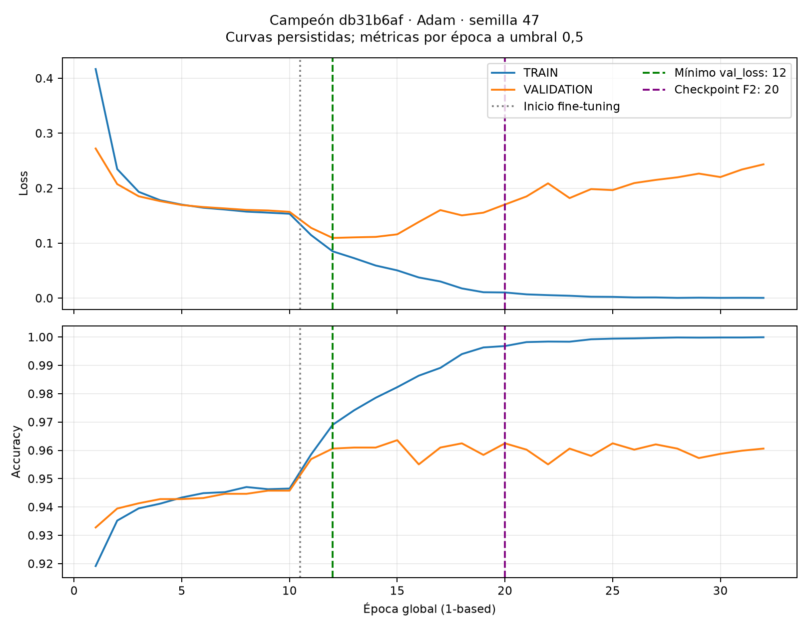
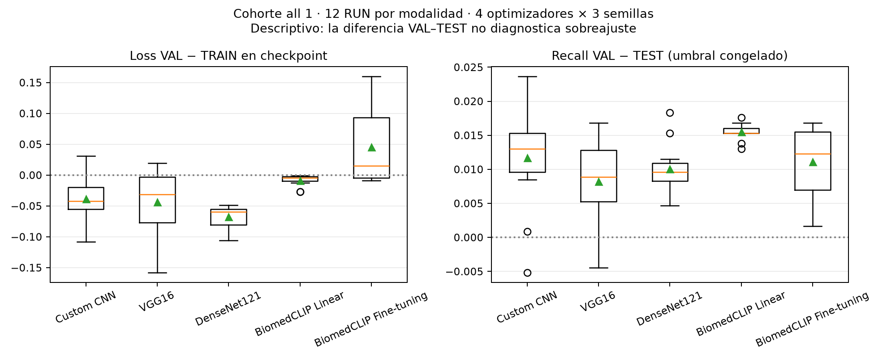

# CAPSTONE-P3-03 — Auditoría científica del Análisis Automático y Sobreajuste

Fecha local: **10 de noviembre de 2026, America/Santiago**. Primera captura PostgreSQL: `2026-11-11T01:05:27Z` (10 de noviembre, 22:05:27 en Chile). Reproducción final del extractor validada a las 22:17:33 locales (`2026-11-11T01:17:33Z`); la captura final de inventario está en `inventory.json`. Repositorio base: `7a2f4636a1b8e79b5f66b056ba6e2263c6d9c964`, con modificaciones previas del usuario preservadas.

## 1. Resumen ejecutivo

**Sí existe evidencia para comparar soluciones IA, errores y señales de sobreajuste ante P3**, siempre que se presenten los historiales y los cálculos de esta auditoría junto con sus limitaciones. El badge «Análisis automático» por sí solo no demuestra evaluación de sobreajuste.

1. Las seis categorías y sus precedencias siguen implementadas. Son heurísticas de riesgo predictivo calculadas en frontend; «Ejecución estable» significa cumplir recall ≥0,98 y specificity ≥0,70 después de las reglas de suficiencia y colapso. No certifica estabilidad del entrenamiento, ausencia de sobreajuste ni desempeño TEST.
2. En la BD actual **ninguno de los 86 TRAIN tiene `parameters.training_results` con `schema_version=training_results_v1`**. La fuente efectiva de las 82 filas con métricas VAL es el SQL de resumen y sus respaldos. El campeón usa la fila clínica final de VALIDATION producida al terminar TRAIN; sus EVALUATE posteriores no sustituyen esta fuente.
3. Campeón `db31b6af-c2a2-44f0-9316-8f8c3492c0f1`: VAL recall **0,98037735849**, categoría estable; TEST recall **0,96962794229**, categoría que daría riesgo FN al aplicar la misma función. La diferencia de etiquetas es coherente con los datos y la lógica vigente. Las tarjetas EVALUATE muestran resultados propios, sin un badge equivalente.
4. Existe una heurística separada de «posible sobreajuste» en RunDetail (`gap accuracy >0,05 OR gap loss >0,10`). Su fuente, `training_history`, contiene **0 filas**. Los **2.425 registros por época** reales están en `train_execution_records`; por ello la página de detalle no recibe esa evidencia por su contrato actual.
5. La campaña «all 1» aporta una cohorte comparable de **60 RUN completados: cinco modalidades × cuatro optimizadores × tres semillas**, con 60 pares VAL–TEST de idéntico checkpoint y decisión de umbral. Hay curvas suficientes para loss/accuracy en todos; Recall TRAIN y F2 TRAIN derivable solo en Keras. No existe F2 TRAIN persistido ni Recall TRAIN en Torch.
6. El campeón presenta una señal temporal compatible con sobreajuste de pérdida/confianza: val_loss pasa de **0,109624729 (época 12)** a **0,243505031 (época 32)** mientras TRAIN loss baja. Checkpoint 20 fue elegido por F2 VAL, no por mínimo val_loss. Esta evidencia es independiente de la brecha VAL–TEST.
7. La activación operativa es una acción manual con verificación técnica y trazabilidad. Existe un comparador científico VAL separado; no hay evidencia de que ese ranking haya seleccionado automáticamente al campeón. La publicación activa ocurrió antes de su TEST y referencia expresamente el intento VAL.

**No se modificaron código productivo, configuraciones, umbrales, checkpoints, modelo activo ni registros PostgreSQL.** Los únicos archivos nuevos son este informe y sus artefactos derivados de auditoría.

## 2. Alcance, fuentes y método

Se inspeccionaron frontend servido (`frontend`), backend FastAPI, motor ML Keras/Torch, configuración Docker, esquema PostgreSQL efectivo, registros de entrenamiento/evaluación/activación y checkpoint local del campeón. No se usó GitHub histórico, fuentes externas, datos simulados como resultados científicos ni exploración masiva de imágenes.

La BD Docker `capstone_db`, base `malaria_experiments`, es la fuente primaria. Extracción mediante `psql -X` y `PGOPTIONS='-c default_transaction_read_only=on -c statement_timeout=60000'`; consultas entregadas dentro de transacciones `READ ONLY`. La captura original de cada JSON usó una sentencia SELECT con lectura obligatoriamente restringida; no se afirma un único snapshot global entre todas las consultas. El servicio `list_training_summaries('malaria',100)` se invocó directamente en `capstone_backend`, con su transacción de solo lectura. Se reprodujo la normalización/clasificación con el helper TypeScript original. No se ejercitó transporte HTTP autenticado ni navegador.

Los cálculos de curvas, brechas, métricas a partir de scores ya persistidos y gráficos son análisis de evidencia existente; **no se ejecutaron nuevas inferencias, TRAIN ni EVALUATE**. El hash SHA-256 del checkpoint activo se calculó leyendo sus bytes, sin deserializarlo.

### Inventario de evidencia

| Evidencia | Resultado | SQL/artefacto |
|---|---|---|
| RUNs actuales | 86 TRAIN; 83 completed y 3 failed | `inventory.sql/json`, `runs.sql/json` |
| TRAIN reales | 82 completados entrenables + 1 zero-shot lógico | `runs.json`, `sessions.json` |
| Historial | 2.425 épocas, 83 RUN con historia; 131 fases; `training_history`=0 | `epochs.sql/json`, `legacy_history.sql/json` |
| EVALUATE | 140 intentos verified: 72 VAL y 68 TEST | `assessment_summary.sql/json`, `assessment_counts.sql/json` |
| Cohorte principal | Campaña `eb7ae3da-c954-4f2f-8d19-0398824089c5`, 61 RUN: 60 completed + 1 failed (reintento exitoso separado) | `campaigns.sql/json`, `cohort_60.csv` |
| Resumen principal | 86/86 filas, limit100; no truncamiento actual | `training_summaries_response.json`, `auto_analysis_rows.csv` |
| Activación | Publicación activa `361b07f8-959f-4941-b446-fddf656099e7` | `deployments.sql/json` |
| Checkpoint campeón | archivo presente, 115.004.676 bytes, hash coincide | `checkpoint_artifacts.sql/json`, `checkpoint_hash_verification.json` |

Artefactos en [docs/audits/CAPSTONE_P3_03](docs/audits/CAPSTONE_P3_03/README.md). Los CSV conservan RUN, attempt, split, checkpoint y threshold donde corresponden. `schema_columns.json` verifica los nombres efectivos; no se impuso ningún contrato histórico ni revisión Alembic.

Niveles de certeza: **alta** = código/registros y cálculo reproducible; **moderada** = interpretación científica compatible con evidencia, sin inferencia causal; **no demostrado** = evidencia insuficiente o prueba no realizada. Los casos sintéticos del helper caracterizan lógica, no resultados de modelos.

## 3. Implementación, normalización, categorías y filtros

### 3.1. Inventario y flujo

- `frontend/src/router.ts:9`: ruta `/modelo-ia/ejecuciones`; `frontend/src/App.tsx:102`: renderiza `<Runs>`.
- `frontend/src/pages/Runs.tsx:267–307`: carga `api.getTrainingSummaries({datasource, limit:100, signal})`, una vez por datasource/reload; no polling ni dependencia de assessment elegido.
- `frontend/src/services/api.ts:1186–1199`: GET `/runs/training-summaries` con datasource y limit; no transformación ni selección científica en el cliente.
- `frontend/src/types/api.ts:271–305`: TrainingSummary con R/S/F2/AUC, matriz, flag y `metrics_split`; `:307–311` colección `items/count/limit`. No incluye un attempt ID ni checkpoint ID fuente de la métrica.
- `Runs.tsx:325–329` aplica filtro URL por TRAIN o hijo ya cargado; `:430–437` pasa los summaries a TrainingRunsTable.
- `TrainingRunsTable.tsx:121,163,169–173`: calcula opciones, métricas, accessor del filtro y cuerpo de análisis con las mismas funciones de runReport; no calcula promedios ni elige EVALUATE.
- `RunSummaryRow.tsx:91–103`: muestra matriz y cuatro métricas; `:106–128`: genera badge desde el TRAIN completo y aparte controla activación; `AutoAnalysisBadge.tsx:9–15`: título/nivel/mensaje y nota «Lectura automática exploratoria».
- `RunSummaryRow.tsx:95`: muestra `Split de métricas` solamente en variante compact. La vista principal usa variante full por defecto y, por tanto, omite VAL en la propia celda. El título «Ejecución estable» tampoco contiene split.
- `backend_api/app/services/training_summaries.py:351–365`: `_summary_row` sobrescribe el resultado SQL con `TrainingResultsV1.validation` cuando existe `runs.parameters.training_results` con schema `training_results_v1`; fija split val y flag collapse None. Esta transformación prevalece sobre el SQL fallback y debe verificarse en cada RUN.

### Normalización exacta

`runReport.ts:110–142`: null/undefined/'' → null. Se usa Number(value), se exige finitud; counts además >=0, métricas sin rango [0,1]. NaN/Infinity y conteos negativos quedan null; cero es válido. Se admiten conteos fraccionarios en el helper y coerción booleana/whitespace, aunque esto excede los tipos normales del API. Pydantic TrainingSummary no limita [0,1] (`backend_api/app/schemas/training_summaries.py:53–65`), counts son int, matrices admiten int|float.

`normalizeConfusionMatrix` (`runReport.ts:144–182`): por cada celda toma el primer conteo válido: propiedad tn/fp/fn/tp → alias true_negative/false_positive/false_negative/true_positive → esos campos de confusion_matrix objeto → matriz fila/columna [[TN,FP],[FN,TP]]. La prioridad se evalúa celda por celda, por lo que una entrada incoherente puede mezclar orígenes dentro del mismo objeto; no valida sumas/tamaños/clases ni consistencia con métricas. `resolveRunConfusion` (:184–186) es solo wrapper.

`resolveRunReportMetrics` (:188–215):

| Salida | Prioridad exacta |
|---|---|
| Recall | recall_parasitized → sensitivity_parasitized → TP/(TP+FN) si denominador>0 → recall |
| Specificity | specificity → TN/(TN+FP) si denominador>0 |
| F2 | f2_parasitized → f2_score; no deriva de la matriz |
| AUC | roc_auc_parasitized → roc_auc → auc |

Solo R/S/F2/AUC cuentan como «métricas» para la suficiencia. Accuracy, Precision, PR-AUC y threshold no intervienen. Una discordancia entre recall_parasitized y matriz gana el valor explícito de recall; specificity explícita gana siempre a su derivada. No existe alerta de discordancia.

### Reglas exactas y precedencias

`generateRunAutoAnalysis` (`runReport.ts:217–299`) retorna UNA categoría, con primer match:

| Orden | Categoría/nivel | Condición y campos |
|---:|---|---|
| 1a | Sin datos suficientes / neutral | Matriz completa (cuatro valores !=null) y suma=0, aun con métricas no nulas o flag=true (:227–233). |
| 1b | Sin datos suficientes / neutral | Ninguna de R/S/F2/AUC resuelta y matriz incompleta (:235–241). |
| 2a | Colapso de predicciones / danger | flag===true, boolean estricto (:243–249), después de suficiencia. |
| 2b | Colapso de predicciones / danger | Matriz completa y (TN+FN)/N >=.95 O (FP+TP)/N >=.95 (:251–264), N>0 porque pasó 1a. |
| 3 | Riesgo por falsos negativos / danger | FN!=null && FN>0 && Recall!=null && Recall<.98 (:266–272). |
| 4 | Riesgo por falsos positivos / warning | Specificity!=null && Specificity<.70 (:274–280); no exige FP disponible ni FP>0. |
| 5 | Ejecución estable / success | Recall!=null && Recall>=.98 && Specificity!=null && Specificity>=.70 (:282–293). |
| 6 | Lectura no concluyente / neutral | Resto (:295–299). |

Los umbrales .98/.70/.95 están fijados en frontend y NO leen `scientific_parameters.target_recall`, min_class_fraction ni reject_prediction_collapse. La clasificación no inspecciona status TRAIN, épocas, curvas, seed, optimizador, EarlyStopping, checkpoint o pérdidas; «estable» significa cumplir dos tasas predictivas y superar condiciones previas, no estabilidad de optimización ni ausencia de sobreajuste.

Solapamientos: FN<.98 y Specificity<.70 simultáneos → prevalece FN. Collapse prevalece ambos. FN>0 es compatible con estable si recall>=.98; no es una afirmación de cero errores. Flag collapse aislado sin métricas/matriz completa → insuficiencia prevalece. Recall<.98 con FN faltante/cero y Specificity>=.70 → no concluyente, no riesgo FN. R y S suficientes sin matriz pueden producir estable. La heurística de distribución >=95% ignora prevalencia real: una población legítimamente muy desbalanceada puede disparar collapse aun con predicciones correctas; una distribución 94.9% en una clase queda fuera salvo flag. No evalúa tamaño de muestra ni incertidumbre: dos tasas perfectas con N pequeño pueden ser «estables».

### Filtros, totals y múltiples evaluaciones

- `TrainingRunsTable.tsx:111–128`: `Set(generateRunAutoAnalysis(training).title)` de todos los TRAIN recibidos; orden alfabético español. No hay catálogo fijo. Collapse no aparece si ninguna fila recibida gana esa categoría (puede estar en un hijo E6 o RUN excluido por límite/URL, o quedar oculto por insuficiencia). No equivale a código eliminado.
- `:168–170`: filtro equals sobre título generado; es exhaustivo para las filas TRAIN cargadas. Opciones no se recalculan con filtros locales, por lo que algunas combinaciones pueden producir cero filas. No abarca todos los experimentos de la BD si el endpoint fue truncado.
- `Runs.tsx:288`: límite 100; API count es len(items), no total BD (`training_summaries.py:389`); no offset ni bucle para descargar resto. `TrainingRunsTable.tsx:94,187–208`: paginación local, 7 por defecto, opciones 7/14/28/50; no trae nuevas filas TRAIN. Cambiar filtro resetea pageIndex; refrescar array por hijos no (:194–195).
- Totales de cabecera (`Runs.tsx:325–339,425–428`) se calculan antes del filtro interno de tabla por análisis/modelo/búsqueda y pueden seguir mostrando N trainings aunque se visualice una subcolección. Sí incorporan filtro URL run. El paginador cuenta filas de tabla filtradas. No deben usarse esos números como total de runs de todo tipo de la BD.
- Hijos lazy (`Runs.tsx:105–175`): GET lineage-children limit100/offset; resultado sustituye página de hijos, no acumula. Solo actualiza evaluation_count y explainability_count del TRAIN (:140–154); nunca sustituye sus métricas.
- `TrainingRunGroupCard.tsx:126–147`: todos los hijos de la página se renderizan separados por attempt o run ID; controles anterior/siguiente (:112–120). Múltiples EVALUATE no se agregan. `AssessmentEvaluationCard.tsx:10–41` muestra verification.metrics solo si state verified, etiqueta explícitamente VAL/TEST, NO llama a generateRunAutoAnalysis ni muestra badge científico.
- No hay selector de evaluación que recalcule badge TRAIN en esta vista. Abrir un assessment lleva a su detalle (:44–54), mientras el TRAIN conserva la métrica elegida por backend. Una selección en otra vista no forma parte de dependencias de carga del TRAIN.
- Filtro URL a un hijo depende del mapa de hijos ya cargados (`Runs.tsx:313–329`); en llegada directa a `?run=assessment:...` sin caché, no se conoce el padre, posible lista vacía. Es un límite de navegación, no pérdida de resultados en BD.
- Modelo activo deriva de `isStage2Active` (`TrainingRunGroupCard.tsx:21–25`): disponibilidad canónica si se cargó, y si no, release_status productive_stage2 sin error. No deriva del nivel success del badge.

### Comprobaciones no destructivas realizadas

Comando (cwd frontend):

```sh
node --test tests/e6-lineage.test.mjs tests/executions-lazy-loading.test.mjs tests/executions-dataset-version.test.mjs tests/executions-scientific-parameters.test.mjs
```

Resultado: 58/58 pass, exit 0, ~0.54s. Son pruebas existentes (algunas estáticas y otras render puro), no verificación de navegador conectado ni reemplazo de PostgreSQL.

Además, se transpilaron `runReport.ts` en memoria con TypeScript y se llamó a sus funciones en Node vm, sin crear/modificar archivos de app. Resultados observados:

| Entrada pura | Resultado |
|---|---|
| Matriz campeón VAL [[1246,122],[26,1299]] | R=.9803773584905661, S=.9108187134502924 → Ejecución estable |
| Matriz campeón TEST [[1262,106],[40,1277]] | R=.9696279422930904, S=.922514619883041 → Riesgo por falsos negativos |
| [[60,40],[10,90]] (ambos riesgos) | FN prevalece |
| [[70,30],[2,98]] (bordes .98/.70) | Estable |
| [[3,97],[2,98]] (95% predicha parasitada) | Colapso |
| {} | Insuficientes |
| {prediction_collapse_detected:true}, sin otros campos | Insuficientes |
| matriz cero + R=S=1 + flag true | Insuficientes |
| R=.9,S=.9, sin FN o FN=0 | No concluyente |
| Solo F2=.99 | No concluyente |
| R=S=2 (fuera de contrato científico) | Estable; no control de rango en helper |
| S=-1 | Riesgo FP |
| recall_parasitized NaN con matriz [[80,20],[2,98]] | Deriva R=.98, estable |
| recall_parasitized=.99 con matriz R=.5/S=.8 | Estable; prioriza métrica explícita |
| counts {tn:' ',fp:false,fn:true,tp:.5} | [0,0,1,.5] en helper |

Las matrices del campeón fueron confirmadas posteriormente por el auditor principal en PostgreSQL (sección 6). Casos sintéticos son caracterización de límites del software, no resultados experimentales.

Certeza: alta para código y resultados puros; no se inspeccionó el DOM de una sesión autenticada. El montaje Docker de `frontend` fue confirmado; esto no equivale a una prueba de navegador.

### Replay del snapshot real del servicio

Se procesó `docs/audits/CAPSTONE_P3_03/training_summaries_response.json`, generado por llamada directa `list_training_summaries('malaria',100)` en backend; esto verifica transformación SQL/servicio más el helper real frontend. No se ejercitó transporte HTTP ni navegador. Script reproducible `replay_run_report.mjs`, salida `auto_analysis_rows.csv`, counts/hashes en `auto_analysis_counts.json`, y 16 assert PASS en `run_report_characterization.json`.

86 filas procesadas: Ejecución estable 50, Riesgo FP 17, Riesgo FN 15, Sin datos suficientes 3, Lectura no concluyente 1, Colapso 0. Splits: 82 val, 4 null. Único resumen productive_stage2: db31b6af-c2a2-44f0-9316-8f8c3492c0f1, Ejecución estable. Flags false82/null4; ninguna distribución completa llega al 95% (máximos positivo .8195321203119198, negativo .5919049387300408). Se comprobó concordancia exacta R/S vs derivación de matrices disponibles (tolerancia 1e-10, cero discrepancias). Esto explica que en snapshot actual no aparezca la opción «Colapso de predicciones».

Caso real de límite de regla FN: d3d42cf3-0800-468c-b3ed-995860967da1, custom_cnn:adam:seed47, completed, split val: R .9086792452830189, S .9780701754385965, F2 .9213345576981941, AUC .9840190410614014, sin TN/FP/FN/TP → «Lectura no concluyente», pese a R baja. No se puede asignar conteo FN exacto solo por esa tasa sin verificar población. Los tres insuficientes son 9b17a7fe-e9e8-4fce-b50e-82b1b0df6675 failed, da07eaa9-459c-4d20-8c13-011f99fce724 failed y 31d27b2d-6e90-4530-a589-ae92c91281df zero-shot ingestion completed.

Advertencia de precisión: existe una heurística de sobreajuste SEPARADA en RunDetail.tsx/runDetail.ts; el componente Análisis automático de la tabla no la llama. Por tanto, no es correcto extender la ausencia de curvas en generateRunAutoAnalysis a una afirmación de ausencia global de toda detección automática del software. Esa heurística se audita en el eje historiales.

## 4. Trazabilidad PostgreSQL → API → frontend y origen real

El flujo vigente es `runs + run_configurations + métricas/evaluations/sesiones → training_summaries.TRAINING_SUMMARIES_SQL → _summary_row → TrainingSummaryCollection → GET /runs/training-summaries → api.getTrainingSummaries → Runs → TrainingRunsTable → resolveRunReportMetrics/resolveRunConfusion → generateRunAutoAnalysis → filtro por título → AutoAnalysisBadge`. Las evaluaciones derivadas viajan por otro flujo de lineage/assessment y no cambian ese objeto TRAIN.

### 4.1. Precedencia de fuentes y efectos

- `backend_api/app/services/training_summaries.py:16–344` limita primero los TRAIN y consulta sus fuentes; `:368–389` ejecuta la consulta en lectura y construye el contrato. Ruta `backend_api/app/routes/runs.py:448–459`, alias `/api/runs/training-summaries`; `limit`1..500. `count` es el tamaño de `items`, no COUNT global.
- **Rama v1 (capacidad, actualmente 0 RUN):** `_summary_row:351–365` lee `runs.parameters.training_results`, valida `TrainingResultsV1`, sustituye métricas y matriz por `.validation`, fija VAL y elimina flag de colapso para evitar mezclarlo con una época. No inferir que esta rama se usó por el nombre del contrato: `runs.json` demuestra que hoy no se activa.
- **Rama SQL efectiva:** selecciona una fila clínica del propio TRAIN, con prioridad `test/external` y luego `created_at DESC` (`:229–249`). No selecciona el EVALUATE hijo más reciente ni el mejor resultado entre sus attempts. Si el padre tuviera clínica TEST sí podría desplazar a VAL; esto es capacidad del SQL, no comportamiento observado del campeón.
- Si falta clínica, las tasas usan datos de `train_execution_sessions.completion.selection`; la matriz puede venir de `train_execution_records` de calibración o `confusion_matrices`. Las fuentes se resuelven por campo y pueden mezclar contextos. `metrics_split` describe el origen escogido de forma global, sin probar identidad común de cada campo.
- `visual_metrics` (`:43–64`) usa MAX por nombre sobre `run_metrics` sin restringir split, epoch, step ni intento. Es un riesgo de mezcla si existen varias filas. En el campeón `run_metrics` está vacío, por lo que este riesgo no explica sus valores actuales.
- `scientific_parameters.threshold` viene independientemente del último `evaluations` con split VAL y role `training_validation_final` (`:202–211`), aunque las métricas clínicas pudieran ser TEST/external. La respuesta principal no incluye evaluation_id/attempt_id/checkpoint de la fila métrica. El origen se reconstruyó consultando PostgreSQL, no desde el contrato visual.

### 4.2. Procedencia por métrica

| Campo | Fuente backend de TRAIN actual / prioridad | Uso frontend | Campeón (VAL) |
|---|---|---|---:|
| `recall` | MAX `run_metrics` recall/recall_macro/sensitivity/test_recall; rama v1 lo sustituiría | Último recurso después de recall clínico/derivado | null |
| `recall_parasitized` | Clínica seleccionada; respaldo selección de sesión | Primera opción; define estabilidad/riesgo FN | 0,9803773584905661 |
| Specificity | Clínica; respaldo selección de sesión | Explícita o TN/(TN+FP) | 0,9108187134502924 |
| F2 | Clínica/selección de sesión; campo genérico MAX aparte | f2_parasitized → f2_score | 0,9663740514804344 |
| Accuracy | No incluida en TrainingSummary | No interviene en badge; disponible en clínica/assessment/historia | Clínica final0,9450427033048645 |
| Precision | No incluida en TrainingSummary | No interviene en badge; disponible en clínica/assessment | 0,9141449683321604 |
| ROC-AUC | Clínica/selección de sesión; MAX genérico aparte | roc_auc_parasitized → roc_auc → auc | 0,9925394460995256 |
| PR-AUC | No incluida en TrainingSummary; clínica final disponible | No interviene en badge | 0,9936018712693304 |
| TN/FP/FN/TP | Prioridad por completitud aparente: clínica, matriz registrada o calibración de campaña; la estructura se normaliza en frontend | Normalización; FN y distribución de predicciones | 1246 / 122 / 26 / 1299 |
| `prediction_collapse_detected` | Clínica `.prediction_collapse.collapsed`/metadata, después selección de sesión | bool estricto o distribución ≥95% | false; respaldo checkpoint 20 |
| Threshold | Última evaluación TRAIN final VAL, en parámetros científicos | Se muestra como parámetro, no cambia las reglas | 0,010405328124761581 |

Fuentes: consulta `champion.sql`, `champion_artifacts.sql`, servicio real `training_summaries_response.json`; `_summary_row`, SQL y `runReport.ts:188–299`. Certeza alta para valores/origen. Accuracy, Precision y PR-AUC de esta tabla son evidencia consultada; no afirmar que esos campos se consumen en el badge principal.

Los attempts E6 se leen desde `assessment_identities` → `assessment_attempts.verification.metrics`; `assessment_results` conserva los scores y etiquetas por muestra. `assessment/contracts.py:188–212` define las tasas y matriz; `verify_rows:215–237` agrega ROC-AUC y PR-AUC para TEST, preservando el contrato histórico de VAL. Por ello el attempt VAL puede no tener AUC en su JSON de verificación aunque la clínica del TRAIN y sus scores lo permitan. PR-AUC usa average precision (`evaluation/clinical_metrics.py:50–57`), no área trapezoidal intercambiable.

## 5. Reglas e inconsistencias verificadas

Las reglas de la revisión preliminar se confirman, con estos matices esenciales: insuficiencia gana a flag de colapso, FN requiere un conteo FN positivo, la categoría estable puede tener errores reales, los umbrales están fijos y no leen la configuración del RUN, y ninguna categoría revisa curvas ni resultados TEST obligatoriamente. El estado técnico completed/failed no es una condición de la función.

En el snapshot completo cargado (86 filas): **50 estables, 17 riesgo FP, 15 riesgo FN, 3 insuficientes, 1 no concluyente y 0 colapsos**. Esto explica la ausencia actual de la opción «Colapso», sin atribuirla a una eliminación de código. Fuente reproducible: `auto_analysis_rows.csv`, `auto_analysis_counts.json`. Certeza alta.

La bandera de ausencia de colapso puede proceder del checkpoint a threshold 0,5 mientras la matriz corresponde a evaluación calibrada. La distribución calculada desde la matriz reduce el riesgo de ocultar un colapso nuevo; no elimina la falta de identidad común del flag. En el campeón ambas matrices son equilibradas y no hay contradicción observada.

## 6. Auditoría del campeón: VALIDATION, TEST y selección operativa

Identidad: RUN `db31b6af-c2a2-44f0-9316-8f8c3492c0f1`, arquitectura `biomedclip_fine_tuning`, optimizador Adam, semilla47; versión dataset `d8c0cab5-09dd-597f-9de7-7ca01aee2ec2`. Configuración real en `run_configurations` y `train_execution_sessions.configuration`; no depende de `runs.configuration`, que es null.

### 6.1. Contraste con PostgreSQL

| Métrica | TRAIN final VAL / E6 VAL `1ea90a63-65ea-41d9-97a0-1469fe671e47` | E6 TEST `7956a4c2-f65a-4e45-848a-499376b3e61f` |
|---|---:|---:|
| N | 2693 | 2685 |
| TN | 1246 | 1262 |
| FP | 122 | 106 |
| FN | 26 | 40 |
| TP | 1299 | 1277 |
| Recall | 0,9803773584905661 | 0,9696279422930904 |
| Specificity | 0,9108187134502924 | 0,9225146198830410 |
| Precision | 0,9141449683321604 | 0,9233550253073030 |
| F2 | 0,9663740514804344 | 0,9600060141332131 |
| Accuracy | 0,9450427033048645 | 0,9456238361266294 |
| ROC-AUC | 0,9925394460995256 | 0,9901451775477672 |
| PR-AUC (AP) | 0,9936018712693304 | 0,9914903425936178 |
| Threshold congelado | 0,010405328124761581 | 0,010405328124761581 |
| Categoría que da `generateRunAutoAnalysis` | Ejecución estable | Riesgo por falsos negativos |

Matrices y tasas coinciden con las capturas, al redondeo indicado. TEST AUC constan en `assessment_attempts.verification.metrics` y fueron recalculadas desde scores ya existentes; para VAL, AUC constan en la clínica TRAIN y se recalcularon desde scores E6 (no forman parte del JSON original de verification VAL). `champion_metrics.csv` distingue ese origen. SQL: `champion.sql`, `champion_artifacts.sql`, `champion_scores.sql`, `assessment_counts.sql`. Certeza alta.

### 6.2. Qué alimenta realmente la fila TRAIN

La clínica ganadora es `run_clinical_metrics.run_clinical_metric_id=f2e5f588-cbc5-418a-ad82-8d53770372ee`, `evaluation_id=b8b14fa0-465b-59c9-92e8-fbaebe1219dd`, split VAL, role `training_validation_final`, creada `2026-10-28T09:33:15.748765Z`. Es posterior a las clínicas default y calibration_selected (`09:33:15.709796Z`) y gana por `created_at DESC`. No hay empate en la fila ganadora del campeón.

El threshold se resuelve desde esa evaluación final VAL; la calibración `c7aa5439-2c5f-5edb-9a64-38b29aa8ccf4` enlaza default `7879976a-be8b-5298-bf40-547deb17545a` y seleccionada `05a75251-377f-5cf9-82dc-1b77764ba1a5`. Recall a threshold 0,5 era **0,9524528301886792**; calibrar el umbral lo lleva a **0,9803773584905661** con mayor FP. No cambió el checkpoint.

El EVALUATE VAL del 29 de octubre reproduce la misma matriz. El EVALUATE TEST posterior permanece en tablas assessment, sin una clínica TEST del padre que desplace VAL. Resultado del servicio real: `metrics_split='val'`, `prediction_collapse_detected=false`, TN1246/FP122/FN26/TP1299 y recall0,980377. El frontend devuelve estable coherentemente. **No es un error de software que VAL y TEST caigan en categorías distintas.** Sí existe una limitación comunicacional: el badge completo principal no explicita el split.

No hay selector E6 en esta vista que recalcule el badge TRAIN. Abrir las evaluaciones muestra sus propias tarjetas/resultados; no transforma el resumen padre.

### 6.3. Checkpoint, activación y cronología

- Checkpoint seleccionado: **época global20**, fase fine_tuning, phase_epoch10; `epoch_20.pt`. SHA-256 `43e60366873f2316657abdea31642131260fc6d1191895bace7180fab5eb9a07`, 115.004.676 bytes. Hash local comprobado contra registro y ambas identidades E6 (`checkpoint_hash_verification.json`).
- `train_execution_sessions.completion.selection` usa `selection_method='explicit_monitor'`, `selected_metric='val_f2_parasitized'`, mode max, threshold 0,5. `policy_satisfied=false`: no logró min_recall0,98 a ese threshold. La advertencia persistida explica que el monitor explícito prevaleció sobre la política configurada `auc_with_min_recall`.
- La calibración VAL posterior en TRAIN eligió threshold 0,010405328124761581. Selección de checkpoint y selección del threshold son pasos distintos; cumplir el target después no vuelve verdadero el estado de la política del checkpoint a0,5.
- Modelo activo: `model_versions.id=a673af1a-d35b-4cec-82ba-227111c99a6a`; publicación `361b07f8-959f-4941-b446-fddf656099e7`; deployment `db14fadf-0767-40bf-bead-4b1bdd4d84ce`, status active, environment stage2, alias default, `threshold_assessment_attempt_id=1ea90a63-65ea-41d9-97a0-1469fe671e47`.
- Activación manual por admin: **29 de octubre de 2026, 15:24:15 America/Santiago** (`18:24:15Z`); TEST inició `22:09:53Z` el mismo día, después de la publicación. La prueba cronológica usa timestamps UTC persistidos; no hay evidencia de uso de este TEST para esa activación.
- El artefacto físico es `67a4c360-265b-5565-ab2f-8a72c11d60bc`. La identidad E6 contiene `64fe7053-bb87-5e65-ab9a-0637ec4f9a4f`, identificador virtual derivado de versión, no una segunda PK física. La equivalencia se comprueba con path/hash/tamaño; no deben confundirse IDs de namespaces distintos.

Los timestamps UTC preservados en los JSON son canónicos para reconstruir el orden; TEST empezó a las 19:09:53 locales del 29 de octubre.

## 7. Historiales y auditoría científica del sobreajuste

### 7.1. Persistencia vigente y nombres reales

El camino CLI `src/train.py:1–8` ejecuta `execution.operations.main`; `training/cli.py:380–393` delega a `execution.train.standalone`. No debe tomarse el módulo de compatibilidad `training/trainer.py` como prueba de que los RUN actuales generaron CSV/JSON de historia. El motor actual declara que usa configuración persistida y no sidecars (`execution/train.py:1`).

- Keras (`custom_cnn`, `vgg16`, `densenet121`): `execution/train.py::PersistEpoch.on_epoch_end`, líneas 161–175, copia todos los logs, agrega `epoch` GLOBAL 1-based, `phase`, `phase_epoch` 1-based, `learning_rate`, y persiste `kind='epoch'`. `compile_binary_model` (`models/architectures.py:153–174`) registra TRAIN `loss`, `accuracy`, `precision`, `recall`, `recall_parasitized`, `specificity`, `balanced_accuracy`, `auc`, `pr_auc`. Keras produce sus correspondientes `val_*`. El callback clínico (`training/keras_callbacks.py:40–54`, `training/checkpoint_policy.py::clinical_validation_logs`, 529–608) agrega VAL `val_f2_parasitized`, `val_pr_auc_parasitized`, `val_roc_auc_parasitized`, `val_recall_parasitized`, `val_sensitivity_parasitized`, `val_specificity`, `val_balanced_accuracy`, distribución por clase, collapse y scores de selección/ES.
- PyTorch/OpenCLIP (`biomedclip_linear`, `biomedclip_fine_tuning`): `execution/train_torch.py:264–293` agrega TRAIN solamente loss y accuracy durante actualizaciones por minibatch. `347–361` construye `loss`, `accuracy`, `val_loss`, `val_accuracy`, agrega las mismas métricas clínicas VAL y persiste la misma identidad global de épocas. NO conserva TRAIN recall, precision ni F2. Sí conserva los scores VAL por muestra por época (371–373).
- `f2_parasitized` TRAIN no aparece directamente en ninguna de las 2.425 épocas reales. Para Keras existe precision+recall genérico en todas las 1.680 épocas: puede derivarse F2 = `5*precision*recall/(4*precision+recall)` y declarar su origen derivado; no existe equivalente para los 745 registros Torch. Cuidado en empates score=0,5: `ParasitizedRecall` usa >= (`architectures.py:31–32`) mientras Precision/Recall genéricos Keras tienen su propia semántica; para derivar F2 usar la pareja genérica coherente y documentarla.
- AUC de Keras `auc`/`pr_auc` y sus `val_*` son métricas de Keras. Las métricas comunes clínicas `val_roc_auc_parasitized` y `val_pr_auc_parasitized` se calculan por el callback. No mezclar ambas familias como si fueran idénticas.
- Zero-shot: `pretrained/training.py::omit_training`, 7–19, consulta `models.metadata.training_mode='logical'`, omite TRAIN local. No tiene épocas ni brecha TRAIN–VAL; sí puede tener evaluaciones predictivas y comparación VAL–TEST.

El ledger se lee explícitamente por familia: `persistence/execution_record_readers.py:8–13` lee los registros históricos con `event_id IS NULL`; 16–28 lee los eventos con `event_id IS NOT NULL`. Evitar contar ambos como dos épocas. La fuente de snapshots de esta auditoría son `epochs.json`, `runs.json` y `sessions.json` exportados de PostgreSQL por el auditor principal.

### Cobertura real en PostgreSQL

El snapshot incluye 2.425 registros `kind='epoch'` y 131 `kind='phase'`. Hay 83 RUN con al menos una época y todos tienen época global consecutiva de 1..N sin duplicados dentro del snapshot. Un historial continuo no demuestra que un RUN fallido haya terminado.

| Modelo | RUN con historia | Completados con historia | Épocas | loss/val_loss y accuracy/val_accuracy | TRAIN recall | TRAIN F2 directo | VAL recall y F2 |
|---|---:|---:|---:|---|---|---|---|
| Custom CNN | 23 | 22 | 392 | 392/392 pares | Sí | No, derivable de precision/recall | Sí |
| VGG16 | 18 | 18 | 526 | 526/526 pares | Sí | No, derivable | Sí |
| DenseNet121 | 18 | 18 | 762 | 762/762 pares | Sí | No, derivable | Sí |
| BiomedCLIP Linear | 12 | 12 | 380 | 380/380 pares | No | No | Sí |
| BiomedCLIP Fine-tuning | 12 | 12 | 365 | 365/365 pares | No | No | Sí |
| Zero-shot | 0 | 0 con historia | 0 | No aplica | No aplica | No aplica | Evaluaciones separadas |

Existen otros 2 RUN fallidos Torch sin época (uno por modalidad), y un Custom CNN fallido con historia parcial. Excluir los fallidos del denominador de comparaciones finales y mantenerlos en el inventario de fallos. El TRAIN lógico zero-shot completado carece correctamente de épocas.

### Existe una heurística automática de sobreajuste, separada del badge

`frontend/src/utils/runDetail.ts::resolveTrainingSignals`, 400–461, implementa una lectura de la última fila con algún valor numérico, ordenada por epoch:

1. `accuracyGap = (train_accuracy ?? accuracy) - val_accuracy`, solo si existe el par en la MISMA fila final.
2. `lossGap = val_loss - (train_loss ?? loss)`, solo si existe el par en esa fila.
3. `possibleOverfitting = accuracyGap > 0.05 OR lossGap > 0.10` (desigualdad estricta).
4. `assessmentAvailable = existe accuracyGap OR existe lossGap`.

No usa curvas posteriores al mínimo, incertidumbre, Recall, F2, TEST, variabilidad ni información del checkpoint; usa el final incluso si el checkpoint seleccionado corresponde a una época anterior. Datos ausentes/no numéricos producen `null`, y la existencia de cualquiera de los dos pares se considera suficiente para una lectura. Un par antiguo completo no se recupera si la última fila con algún número está incompleta.

`RunDetail.tsx:607` alimenta esta función con `detail.training_history`. `backend_api/app/routes/runs.py:687–701` lo carga EXCLUSIVAMENTE de `training_history`. La BD actual tiene 0 filas en esta tabla, por lo que la capacidad de código existe pero la página no recibe las 2.425 épocas disponibles en `train_execution_records`. UI muestra “Historial insuficiente”; la ausencia de una alerta aquí no significa ausencia de señales en la evidencia científica. La discrepancia de fuentes es un hallazgo de integración, sin corregirlo en esta auditoría.

Los textos visuales son explícitamente heurísticos: `RunDetail.tsx:395–402` y `873–880` dicen “posible sobreajuste” y “no se activaron señales fuertes”. La bandera de riesgo predictivo de la tabla de ejecuciones es otra función y no evalúa sobreajuste.

Existe además una diferencia de indexación latente: `resolveTrainingSignals:454–457` suma 1 a epoch para mejor val_accuracy/inicio fine tuning, y `RunDetail.tsx:635–636` suma 1 para épocas completadas; los registros actuales ya son 1-based globales. Actualmente no se manifiesta desde training_history vacía. Documentar sin afirmar que se observó una época incorrecta en la UI actual.

### Campeón: evidencia temporal independiente de VAL–TEST

RUN `db31b6af-c2a2-44f0-9316-8f8c3492c0f1` tiene 32 épocas globales, 10 base y 22 fine_tuning. `sessions.json` conserva selección del checkpoint global 20. Todos los siguientes valores son de registros `kind='epoch'`, split TRAIN/VAL de entrenamiento, threshold de monitorización 0,5; no son las métricas clínicas calibradas de EVALUATE.

| Punto | epoch | train loss | val loss | val−train loss | train acc | val acc | train−val acc |
|---|---:|---:|---:|---:|---:|---:|---:|
| Mínimo val_loss | 12 | 0,08524844099 | 0,10962472856 | 0,02437628757 | 0,96902614968 | 0,96063869291 | 0,00838745678 |
| Checkpoint seleccionado | 20 | 0,01039055735 | 0,17042781413 | 0,16003725678 | 0,99684400361 | 0,96249535834 | 0,03434864527 |
| Última época | 32 | 0,00053658447 | 0,24350503087 | 0,24296844641 | 0,99995491434 | 0,96063869291 | 0,03931622143 |

val_loss aumenta 0,13388030231 entre mínimo 12 y final 32 mientras train loss sigue bajando. Es una señal temporal compatible con sobreajuste de la pérdida/confianza; el diagnóstico merece revisar toda la trayectoria y no significa colapso ni invalida por sí solo el checkpoint 20. Esta señal usa TRAIN–VAL, independientemente de que recall TEST sea menor que VAL. La brecha accuracy no supera 0,05; la de loss sí supera 0,10 en checkpoint 20 y final 32. La UI actual no calcula esta alerta porque consulta la tabla vacía.

`kind='phase'` del campeón: base epochs10, ES best_epoch4 y stopped_epoch0; fine_tuning epochs22, best_epoch9 y stopped_epoch21. Los índices del callback son 0-based LOCALES a la fase: fine best9 corresponde a global20, stopped21 a global32. Paciencia12 explica los 12 pasos tras la mejor época clínica. No confundir época mínimo val_loss12 con mejor checkpoint F2 20 ni mejor ES (que aquí coincide en F2 con checkpoint).

Listado SOLO de nombres/tamaños del directorio `malaria_dl_local_project/outputs/campaign_runs/db31b6af-c2a2-44f0-9316-8f8c3492c0f1` confirmó `epoch_1.pt` a `epoch_32.pt`, sin sidecars de historia en ese directorio. Epoch1–10 pesan 5029 bytes (cabeza), epoch11–32 115004676 bytes (bloques ajustados). No se cargó ni modificó ningún checkpoint. Esto verifica presencia local, no un hash completo de cada binario.

### Qué indicadores permiten los registros y sus límites

| Indicador | Disponibilidad | Límite científico |
|---|---|---|
| loss VAL−TRAIN y accuracy TRAIN−VAL | Todos los entrenables, cada época; calcular final y checkpoint por separado | TRAIN agrega minibatches con pesos que cambian, dropout/augmentation activos; VAL evalúa pesos al final y en inferencia. Loss puede incluir regularización Keras; no comparar escalas absolutas entre recetas indiscriminadamente. |
| Recall TRAIN−VAL | Keras sí; Torch no | TRAIN en modo entrenamiento, VAL inferencia; umbral fijo0,5. No sustituir con recall calibrado posterior. |
| F2 TRAIN−VAL | Keras derivable; Torch no | Etiquetar derivación de precision/recall, documentar denominador cero y semántica threshold. No afirmar F2 TRAIN persistido. |
| Mínimo val_loss y crecimiento posterior | Todos los entrenables | Separar fases y transiciones de entrenamiento; aumento de pérdida puede reflejar mala calibración/confianza aunque accuracy apenas cambie. Selección de mejor época basada en misma VAL puede ser optimista. |
| Checkpoint y EarlyStopping | records selection / sessions completion y phase | ES y checkpoint son objetivos configurados, no necesariamente mínimo val_loss. Fases tienen contadores locales0-based; épocas ledger global1-based. Restaurar pesos de ES en memoria no determina el checkpoint final: motores recargan explícitamente archivo de selección (train.py:289–294; train_torch.py:384–389). |
| VAL–TEST | Assessment/evaluation con misma identidad checkpoint, threshold, dataset y semántica | Es una diferencia de generalización a poblaciones distintas; no prueba automática de sobreajuste. Preservar TEST para estimación final; no elegir modelo por el gap más favorable. |
| Variabilidad por semilla/optimizador | RUN/session config + evaluaciones | Comparar mismas configuraciones salvo factor estudiado, split/pacientes y protocolo; n pequeño y semillas emparejadas no son pacientes independientes ni CI clínicos. No agregar reintentos como réplicas científicas. |
| Población/paciente | metadata/splits gobernados y muestras VAL por época | Scores por muestra permiten análisis de trayectorias; la estabilidad entre pacientes necesita agrupación y métricas por paciente calculadas explícitamente. No queda probada por media global ni por agrupación del dataset. |

Reaplicar la heurística de RunDetail a las últimas épocas del ledger (análisis del auditor, NO estado observado de la UI) da señales en 1/23 Custom CNN, 0/18 VGG, 0/18 Dense, 0/12 Linear, 6/12 Fine-tuning. El denominador Custom incluye el fallido con historia; para la matriz final usar solo completados. Estas cantidades describen una regla exploratoria sin validación clínica y no una prevalencia demostrada de sobreajuste por arquitectura. No extraer conclusiones de superioridad de los promedios de gaps porque semillas/optimizadores y fases no forman una muestra homogénea.

Certeza: alta para comportamiento de código, existencia/campos/contadores del snapshot y valores del campeón; moderada para interpretación de sobreajuste como señal; insuficiente para superioridad estadística o generalización clínica externa. No se hicieron TRAIN/EVALUATE nuevos ni se alteró software, DB o artefactos originales.

### Completitud por fase y learning rate (verificación adicional)

Se cruzaron los 131 registros `kind='phase'` con sus épocas por `(run_id, phase)` y se verificó que `phase_epoch` es exactamente `1..phase.payload.epochs`, sin discrepancias. También se cruzó cada `train_execution_sessions.completion.epochs` disponible contra el número de registros epoch del RUN: 0 discrepancias. “Historial completo” significa que se preservaron todas las épocas efectivamente ejecutadas hasta la finalización/ES; NO significa que se agotó `max_epochs + fine_tune_epochs`. Los fallidos conservan historia parcial y se separan de los finalizados aunque sus registros sean internamente consecutivos.

El callback ES conserva índices LOCALES 0-based mientras los logs y `selected_epoch` son GLOBALES 1-based. Para reconstruir global ES: `offset de épocas previas + best_epoch + 1` o `offset + stopped_epoch + 1`; `stopped_epoch=0` puede ser el valor inicial sin parada y no demuestra parada en la primera época. La evidencia fase+completion y presupuesto es necesaria para distinguir max budget de EarlyStopping.

Se cotejó adicionalmente el `learning_rate` de la primera época de cada fase de TODOS los RUN Keras con `sessions.configuration.resolved.optimizer.parameters.learning_rate` (base) o `fine_tune_learning_rate` (ajuste), tolerancia relativa 1e-6 y absoluta 1e-12: 0 discrepancias. El valor 1 observado en algunos payloads corresponde a configuraciones Adadelta cuyo learning rate también es 1; el snapshot no sustenta afirmar un LR=1 frente a configuración 0,001 en esos registros. LR posteriores pueden disminuir por ReduceLROnPlateau y el callback guarda el valor ya actualizado después de ese callback (`execution/train.py:251–253` y 170–172; Torch 355–360). Interpretar ese LR como valor registrado al cerrar época, sin asumir que rigió todos sus minibatches.

## 8. Matriz comparativa y cálculos cuantitativos

### 8.1. Cohorte y reglas del cálculo

Se eligió la campaña completa **all 1**, ID `eb7ae3da-c954-4f2f-8d19-0398824089c5`, por pertenencia experimental, sin elegir RUN por resultados TEST. Incluye **60 completados, 12 por modalidad**, con Adadelta/Adam/AdamW/SGD y semillas 11/29/47. Un intento fallido Fine-tuning queda en el inventario y se usa su reintento completo como miembro científico; no cuenta como semilla adicional. Los experimentos anteriores se conservan en `per_run_indicators.csv`, sin mezclarlos con esta cohorte.

SQL `cohort_population.sql/json` verificó las mismas 2693 muestras VAL y 2685 TEST en los 60 intentos de cada split, sin conflictos de etiquetas o pacientes y sin muestras fuera de las asignaciones gobernadas. Todos usan la misma versión dataset; 60/60 historias continuas coinciden en número con `completion.epochs` y todas sus fases tienen `phase_epoch`1..N. La cohorte reúne **1.933 épocas**. Todos los pares VAL–TEST tienen el mismo hash de checkpoint, `decision` completa, dataset/procedencia y definición métrica. Existe un solo attempt verified por split en cada RUN de la cohorte. `cohort_code_identity.csv` confirma la identidad completa del modelo y del código salvo Git commit: VAL usa `14aef45…`; TEST usa `1b18f795…` en 55 pares y `0e8c9ce8…` en 5, con idénticos `source_sha256`, paquetes, entorno de determinismo y contrato del modelo en 60/60. No se afirma congelación del mismo commit Git; el cambio de commit no implica por sí solo un cambio en la fuente efectiva registrada. En general el script toma el primer verified por inicio/ID, sin usar su rendimiento, preservando reintentos como identidades distintas.

TRAIN–VAL se calcula **en la época del checkpoint elegido, con monitorización a umbral 0,5**. Se entrega también el final del entrenamiento, separado. VAL–TEST usa los **assessments al umbral efectivo congelado**, que puede ser calibrado y distinto de0,5. No se resta TRAIN a0,5 de VAL calibrado. Las pérdidas se analizan dentro de cada receta/fase; no se interpreta su magnitud entre frameworks como ranking de generalización.

Las medias de 12 RUN combinan cuatro optimizadores y tres semillas y son **descriptivas de esta cohorte**, no estimaciones de un efecto puro de arquitectura ni intervalos clínicos. La variabilidad exclusivamente entre semillas se entrega por modalidad/optimizador (`optimizer_seed_summary.csv`, n3, SD muestral ddof1). No se agrupan las predicciones de las 12 ejecuciones como si fueran muestras independientes.

### 8.2. Matriz científica solicitada

Brecha loss=VAL−TRAIN; brecha accuracy=TRAIN−VAL; ΔRecall y ΔF2=VAL−TEST en los assessments. Historial completo significa todas las épocas ejecutadas hasta terminar o detenerse, sin exigir agotar el presupuesto máximo. Valores de brecha en checkpoint y medias descriptivas de 12 RUN. Señales corresponden a reaplicar la heurística exploratoria del detalle a la última época del ledger; **no son alertas observadas en la UI ni diagnósticos validados**.

| Modalidad | Historial completo | Brecha TRAIN–VAL | Señales de sobreajuste | Brecha VAL–TEST | Evidencia suficiente |
|---|---|---|---|---|---|
| Custom CNN | Sí,12/12;260 épocas | loss -0.038768; acc -0.031731; Recall sí; F2 derivable | 0/12 con señal heurística final; revisar trayectoria individual | ΔRecall 0.011697; ΔF2 0.018793 | Sí para señales loss/accuracy; parcial para conclusión global de sobreajuste |
| VGG16 | Sí,12/12;387 épocas | loss -0.043438; acc -0.021174; Recall sí; F2 derivable | 0/12 con señal heurística final; revisar trayectoria individual | ΔRecall 0.008218; ΔF2 0.002820 | Sí para señales loss/accuracy; parcial para conclusión global de sobreajuste |
| DenseNet121 | Sí,12/12;541 épocas | loss -0.067713; acc -0.048594; Recall sí; F2 derivable | 0/12 con señal heurística final; revisar trayectoria individual | ΔRecall 0.010053; ΔF2 0.001864 | Sí para señales loss/accuracy; parcial para conclusión global de sobreajuste |
| BiomedCLIP Linear | Sí,12/12;380 épocas | loss -0.008568; acc -0.002119; sin Recall/F2 TRAIN | 0/12 con señal heurística final; revisar trayectoria individual | ΔRecall 0.015496; ΔF2 0.014678 | Sí para señales loss/accuracy; parcial para conclusión global de sobreajuste |
| BiomedCLIP Fine-tuning | Sí,12/12;365 épocas | loss 0.045409; acc 0.011159; sin Recall/F2 TRAIN | 6/12 con señal heurística final; divergencia temporal marcada en campeón | ΔRecall 0.011129; ΔF2 0.009868 | Sí para señales loss/accuracy; parcial para conclusión global de sobreajuste |

Ninguna fila con cero señales permite concluir «sin sobreajuste»: la regla de una única época puede omitir tendencias y usa umbrales arbitrarios no validados científicamente. Brechas negativas son compatibles con augmentation/dropout/regularización y TRAIN por minibatches; no prueban generalización superior. Los datos Torch no permiten calcular Recall/F2 TRAIN sin nueva evidencia, que esta fase no genera.

| Modalidad | Δloss checkpoint | Δloss final | Δaccuracy checkpoint | ΔRecall TRAIN−VAL checkpoint | ΔF2 derivado TRAIN−VAL checkpoint |
|---|---:|---:|---:|---:|---:|
| Custom CNN | -0.038768 | -0.004765 | -0.031731 | -0.065215 | -0.052903 |
| VGG16 | -0.043438 | 0.018774 | -0.021174 | -0.025911 | -0.023866 |
| DenseNet121 | -0.067713 | -0.069853 | -0.048594 | -0.027682 | -0.033332 |
| BiomedCLIP Linear | -0.008568 | 0.001387 | -0.002119 | No disponible | No disponible |
| BiomedCLIP Fine-tuning | 0.045409 | 0.112799 | 0.011159 | No disponible | No disponible |

F2 TRAIN en Keras se deriva de precision/recall genéricos registrados; no se denomina métrica persistida ni idéntica a `recall_parasitized` ante empates exactos en0,5. Diferencias pequeñas pueden reflejar definición numérica. El CSV conserva los valores originales y los derivados por separado.

### 8.3. Desempeño predictivo y variabilidad entre semillas

Valores calibrados de los assessments. R=recall, S=specificity. Cada fila agrupa tres semillas compartidas; SD es muestral entre semillas y **no** incertidumbre por paciente.

| Modalidad | Optimizador | R VAL media | S VAL media ± SD | R TEST media ± SD |
|---|---|---:|---:|---:|
| Custom CNN | adadelta | 0.980377 | 0.855507 ± 0.039806 | 0.969375 ± 0.003161 |
| Custom CNN | adam | 0.981132 | 0.850146 ± 0.063040 | 0.966338 ± 0.004384 |
| Custom CNN | adamw | 0.980377 | 0.827729 ± 0.127810 | 0.971400 ± 0.007014 |
| Custom CNN | sgd | 0.980377 | 0.830409 ± 0.100569 | 0.968362 ± 0.015211 |
| VGG16 | adadelta | 0.980126 | 0.842593 ± 0.019741 | 0.967856 ± 0.004577 |
| VGG16 | adam | 0.980377 | 0.861355 ± 0.005954 | 0.980764 ± 0.005749 |
| VGG16 | adamw | 0.980377 | 0.882554 ± 0.005487 | 0.972918 ± 0.004940 |
| VGG16 | sgd | 0.980881 | 0.816033 ± 0.030548 | 0.967350 ± 0.003037 |
| DenseNet121 | adadelta | 0.980377 | 0.690058 ± 0.061404 | 0.966591 ± 0.005475 |
| DenseNet121 | adam | 0.980629 | 0.607700 ± 0.016707 | 0.970640 ± 0.001911 |
| DenseNet121 | adamw | 0.980377 | 0.609649 ± 0.009503 | 0.971906 ± 0.002738 |
| DenseNet121 | sgd | 0.980377 | 0.619396 ± 0.023050 | 0.972412 ± 0.002875 |
| BiomedCLIP Linear | adadelta | 0.980377 | 0.730750 ± 0.020485 | 0.964566 ± 0.000877 |
| BiomedCLIP Linear | adam | 0.979874 | 0.780458 ± 0.010243 | 0.965072 ± 0.001315 |
| BiomedCLIP Linear | adamw | 0.980126 | 0.779971 ± 0.009670 | 0.965072 ± 0.001315 |
| BiomedCLIP Linear | sgd | 0.980377 | 0.730263 ± 0.018794 | 0.964060 ± 0.001160 |
| BiomedCLIP Fine-tuning | adadelta | 0.980377 | 0.696881 ± 0.012836 | 0.965325 ± 0.001160 |
| BiomedCLIP Fine-tuning | adam | 0.980377 | 0.893762 ± 0.014789 | 0.973678 ± 0.004182 |
| BiomedCLIP Fine-tuning | adamw | 0.980377 | 0.894006 ± 0.012491 | 0.973931 ± 0.004577 |
| BiomedCLIP Fine-tuning | sgd | 0.980126 | 0.762427 ± 0.007049 | 0.963807 ± 0.001160 |

La calibración persigue recall VAL≈0,98, por lo que las diferencias de especificidad y FP al alcanzar ese objetivo son comparativamente informativas. No usar resultados TEST de esta tabla para escoger retrospectivamente un ganador. Diferentes presupuestos de entrenamiento y modalidades de ajuste son parte de las soluciones comparadas; se necesita controlar receta/configuración para atribuir causalmente diferencias a una arquitectura u optimizador. La misma división de pacientes permite emparejar los datos, pero no sustituye un análisis explícito por paciente o incertidumbre clínica.

Los20 grupos, sus RUN IDs y todas las SD están en `optimizer_seed_summary.csv`. Cada valor de matriz se rastrea hasta `cohort_60.csv`, `per_run_indicators.csv` y `epoch_metrics.csv`; assessment IDs/splits/thresholds y hashes de checkpoint se conservan por RUN. Certeza alta para cómputos; moderada para interpretar señales; no demostrada superioridad estadística.

### 8.4. Figuras exportables



[Curvas en PDF](docs/audits/CAPSTONE_P3_03/champion_curves.pdf). La pérdida VAL crece tras época 12 mientras accuracy cambia poco; checkpoint 20 y final 32 se distinguen. No se usa TEST en estas curvas.



[Brechas en PDF](docs/audits/CAPSTONE_P3_03/cohort_gaps.pdf). Boxplot sobre 12 RUN por modalidad; el panel VAL–TEST describe transferencia al split reservado y no diagnostica sobreajuste.

## 9. Política de selección del campeón y activación

### De la selección de checkpoint a la validación persistida

`execution/train.py:174-206` registra cada época y selección, archivos exclusivos por época. La selección aplica monitor explícito (`selection.explicit`) o política clínica; `execution/train_torch.py:361-392` hace lo mismo para PyTorch. Se recarga el fichero de la época seleccionada, no el estado de la última época (`train.py:287-297`, `train_torch.py:384-392`). Después `finish_training` (`train.py:300-334`) calibra sólo VAL del checkpoint elegido y emite evaluación final VAL con threshold efectivo. `persistence/v2_projection.py:129-154` persiste `evaluations` role training_validation_final y `run_clinical_metrics` asociados al TRAIN; calibración tiene dos evaluaciones adicionales calibration_default/calibration_selected (`:157-211`). Esto explica las tres filas clínicas VAL del campeón.

La política de checkpoint por defecto `auc_with_min_recall` (`training/checkpoint_policy.py:46-54,332-428`) excluye épocas colapsadas si existen no colapsadas; si todas colapsan permite fallback y advierte (`:284-307`). Entre épocas recall >= min_recall rankea AUC, F2, specificity, -val_loss, epoch; si ninguna cumple elige mejor recall y policy_satisfied=false. Otras políticas implementadas maximizan F2, VAL AUC o balanced accuracy; monitor explícito puede gobernar aparte. No es una política global de RUN campeón.

La calibración (`evaluation/calibration_controller.py:28-42`) usa target_recall/min_specificity de snapshot, o threshold=.5 si deshabilitada. `threshold_calibration.py:200-228` exige recall >= target, intenta mínimo specificity opcional, si no puede satisfacer ambos vuelve a recall; desempata specificity, precision, F2, balanced accuracy y threshold mayor (`:126-146`). No utiliza TEST. El threshold de calibración y el checkpoint pertenecen a etapas distintas; valores de época a .5 pueden diferir de final VAL calibrada.

### Identidades de checkpoint: diferencia explicada

E6 crea identidad lógica `uuid5(UUID(version_id),'e5-selected-checkpoint')` (`assessment/lineage.py:70-86`). El registro V2 usa `uuid5(UUID(run_id),'model_checkpoint:'+version_id)` (`execution/repository.py:295-317`). Pueden diferir IDs para los mismos bytes. `register_evidence` (`repositories/cell_activation.py:41-73`) busca artifact por ID O mismo run/checksum/tamaño, reutiliza el registro físico y verifica coincidencias. No se debe declarar bug sólo por IDs distintos en JSON E6 y artifacts. Para campeón, path epoch_20.pt, SHA y tamaño coinciden entre identidad E6 y artefacto operativo; el ID lógico no necesita ser PK física.

### Política recomendada versus implementada

| Regla propuesta | Capacidad vigente | Uso en activación operativa |
|---|---|---|
| Completa, trazable y sin colapso | Verificación de TRAIN, contratos, hashes y checkpoints; selector épocas evita colapso con fallback | `stage2_eligibility` devuelve elegible si run_type training; informa train_completed/evaluate_completed pero no los exige allí. Readiness/contrato y carga/smoke sí pueden bloquear. No exige umbral de métricas ni ausencia de colapso |
| Recall VAL >= .98 | Checkpoint/calibración configurable; heurística frontend fija | No es requisito de CellActivationService |
| Desempate specificity/FP | Calibración threshold sí; selector de época prioriza AUC antes de F2/spec | No ranking global automático para activar |
| Variación semillas/optimizadores/pacientes | Módulo ciencia E7 y reportes permiten evidencias comparativas | Activación recibe un TRAIN manual, no integra estos análisis |
| Congelar checkpoint/threshold antes TEST | Identidad E6 incluye bytes/hash, dataset y decisión; final locks disponibles | Campeón publicación VAL y threshold anteriores a su TEST. No hay assessment_final_locks en snapshot auditado |

`select_evaluation` elige la evaluación completada más reciente para entrenables, con orden del repositorio por finished_at y started_at DESC; esa evaluación podría ser TEST. Para zero-shot prefiere la E6 VAL calibrada. Por tanto **el software permite que una activación manual use identidad/threshold de un TEST reciente**, aunque no rankea candidatos por resultados TEST. No equivale a demostrar que el campeón fue seleccionado mediante TEST. El registro real activa el campeón el 29-10-2026 18:24Z con attempt VAL 1ea90a63..., antes del TEST posterior 22:09Z. Además la activación es idempotente para misma model_version entrenable (`cell_activation.py:95-106`): evaluaciones nuevas no reescriben automáticamente la publicación.

Separadamente existe `science/comparison.py:239-300`, `select_candidate`: prohíbe selección TEST, exige matriz original configuraciones×semillas completa y misma población/entorno; objetivo sensibilidad **> .98** en todas las semillas (estricto, diferente de >=.98 de propuesta/frontend), rank media specificity y F2; si no alcanza objetivo propone candidato exploratorio por mejor mínimo recall. Semilla representativa predefinida, `production_selection='manual_unchanged'`. `science/repository.py:162-235` puede congelar identidad TEST final exacta y guardar `assessment_final_locks`; tener capacidad implementada no demuestra ejecución del protocolo ni que seleccionara al campeón. En la BD auditada no hay locks.

Modelo operativo actual se identifica mediante `stage2_model_publications` activa -> `model_versions` -> `artifacts` y `deployed_model_versions` activo en stage2/default. `ProductiveModelResolver` exige unicidad, valida contrato/artefacto/threshold y expone IDs; no calcula campeón por métricas. `runs.release_status='productive_stage2'` es estado de publicación, no prueba de superioridad científica. Este entorno es stage2_experimental; no confundir con environment production/alias champion de otro circuito de governance.


Endpoints y funciones operativas verificables: GET `/stage2/productive-model-availability` (`routes/governance.py:202–206`) resuelve el modelo; POST de activación (`:226–233`) recibe el TRAIN explícito y requiere MODELS_PUBLISH. `CellActivationService.activate/_activate` (`services/cell_activation.py:71–183`) no ejecuta el comparador científico para escoger un RUN. `ProductiveModelResolver._fetch_candidates/resolve_current_stage2_productive_model/availability` (`services/productive_model.py:329–435,996–1059`) exige publicación/deployment únicos, no maximiza una métrica.

La activación sí puede usar la evaluación más reciente —incluyendo TEST para entrenables— como evidencia/threshold de una decisión manual futura. El campeón ya activo mantiene su publicación por idempotencia; su TEST nuevo no la sustituye automáticamente. Esta capacidad es distinta de usar TEST para un ranking científico, que E7 prohíbe. En el caso real solo se demuestra publicación con VAL previa a TEST; no se demuestra el proceso mental del usuario ni un protocolo preregistrado de selección.

## 10. Riesgos, inconsistencias, limitaciones y bloqueos

| ID / prioridad | Hallazgo | Evidencia concreta | Interpretación y certeza |
|---|---|---|---|
| R1 / alta | Badge «estable» puede leerse como ausencia de sobreajuste/generalización TEST | `runReport.ts:217–299`, campeón VAL .980377, TEST .969628 | Semántica predictiva limitada; alta |
| R2 / alta | Heurística de sobreajuste no consume la historia vigente | `RunDetail.tsx:607`, `routes/runs.py:687–701`, `legacy_history.json`=0 vs 2425 epochs | Integración de fuentes insuficiente; alta por contrato/datos, DOM no probado |
| R3 / alta | Summary no conserva identidad única de métricas/checkpoint/threshold | `training_summaries.py:43–64,149–339`; SQL clínica, matrices, MAX, threshold independientes | Riesgo de mezclar contextos; no se observó mezcla dañina en campeón; alta para posibilidad |
| R4 / media | Riesgo FN se omite si falta FN aunque recall sea bajo | RUN `d3d42cf3-0800-468c-b3ed-995860967da1`, VAL .908679, sin matriz | «No concluyente» según regla; cobertura de riesgo incompleta; alta |
| R5 / media | Umbrales frontend fijos y diferencias >= vs > | Badge .98/.70/.95; checkpoint/configurable; E7 >.98 | Son políticas distintas y deben explicitarse; alta |
| R6 / media | Mayoría ≥95% no distingue prevalencia/collapse funcional | `runReport.ts:251–264` | Posible falsa alarma con poblaciones desequilibradas; límite lógico, no caso experimental observado |
| R7 / media | Filtro/totales/límite con ámbitos distintos | limit100, local7 filas, count=len(items), opciones por resultados cargados | Hoy86/86; riesgo de truncamiento futuro y totales no filtrados; alta |
| R8 / media | Recall/F2 TRAIN no homogéneos entre frameworks | `train_torch.py:264–293,347–361`, `epoch_metrics.csv` | No se puede completar comparación de esas brechas en Torch; alta |
| R9 / media | VAL reutilizada para checkpoint, umbral y comparación | `sessions`, `evaluations.protocol_snapshot.limitations.shared_val` | Sesgo optimista posible; capacidad de selección no demuestra validación independiente; alta para reutilización, magnitud no estimada |
| R10 / media | Activación técnica no impone la política científica propuesta | `cell_activation.py`, `eligibility.py`, `science/comparison.py` | Estado activo no prueba ser ganador estadístico; alta |
| R11 / baja | Índices0-based del detalle frente a ledger1-based | `runDetail.ts:454–457`, `RunDetail.tsx:635–636` | Latente si se conectan fuentes sin normalizar; no observado en UI actual |
| R12 / evidencia | Raíces de artefactos E6 VAL/TEST del campeón no existen localmente | `champion.json` attempt.artifact_root; `Path.is_dir()` false; `assessment_artifacts` sin filas para esos attempts | No bloquea verificación numérica: resultados completos están en PostgreSQL. No certificar presencia de sidecars no encontrados |

**No hay un bloqueo que impida la auditoría de categorías, procedencia, campeón, historiales o política.** Sí quedan límites concretos de certificación:

- No se inspeccionó una sesión autenticada del navegador ni transporte HTTP end-to-end. Para comprobarlo: iniciar sesión existente, abrir `/modelo-ia/ejecuciones?datasource=malaria`, capturar el GET `/runs/training-summaries?datasource=malaria&limit=100` y comparar su fila db31... con `training_summaries_response.json`; abrir sus dos EVALUATE y contrastar attempts. Solo navegación/GET, sin botones ejecutar/activar/publicar. El servicio y helper sí se ejecutaron contra datos actuales.
- No existen Recall/Precision/F2 TRAIN Torch en los registros. Para resolverlo posteriormente se requeriría instrumentación o evidencia adicional autorizada; no puede recuperarse el modo entrenamiento exacto de todas las épocas a partir de scores VAL ni inventarse usando TEST. No se generaron esos datos en esta fase.
- No se midió incertidumbre ni desempeño clínico por paciente, ni validación externa. Para resolverlo sin nuevos experimentos, analizar `assessment_results.payload.patient_id` de los attempts fijados con protocolo/agrupación definidos y reportar intervalos; los identificadores existen. Esto sería un análisis posterior, no una conclusión ya probada aquí.
- `assessment_final_locks` está vacío: no se certifica congelación formal preregistrada. Sí están demostrados igualdad de bytes/threshold entre VAL–TEST y orden cronológico de publicación antes de TEST. Preservar esa distinción.
- Para comprobar artefactos E6 ausentes, consultar `assessment_artifacts` por attempt y la raíz registrada en el host/volumen de origen. No recrearlos ni sustituirlos durante una auditoría. Los scores presentes permiten reproducir todas las métricas citadas sin esos directorios.

## 11. Conclusiones explícitas para la rúbrica P3

**¿La evidencia actual permite demostrar ante la comisión que comparamos soluciones IA y evaluamos indicadores de errores y sobreajuste? Sí, con el análisis cuantitativo adjunto y una formulación acotada de las conclusiones. El software por sí solo no automatiza íntegramente esa evaluación científica.**

| Dimensión | Demostrado | Parcialmente demostrado | No demostrado / evidencia adicional |
|---|---|---|---|
| A. Comparación de soluciones | Cinco modalidades entrenables, cuatro optimizadores, tres semillas, cohorte 60, misma versión, matrices/metrics trazables; zero-shot separado | Atribución de diferencias a arquitectura/optimizador porque las recetas y presupuestos cambian; análisis descriptivo de semillas | Superioridad estadística global, selección automática del campeón por toda la política, generalización externa |
| B. Indicadores de errores | TN/FP/FN/TP, Recall, Specificity, Precision, F2, AUC; campeón VAL/TEST contrastados con BD y scores; categorías/restricciones auditadas | Badge heurístico resume parcialmente riesgos y no cuantifica incertidumbre ni todos los riesgos simultáneos | Que «estable» signifique cero errores, seguridad clínica o cumplimiento del objetivo en TEST |
| C. Sobreajuste y generalización | Curvas por época, gap TRAIN–VAL de loss/accuracy, mínimo val_loss, checkpoint, ES; señal temporal del campeón; VAL–TEST a identidad congelada | Recall/F2 TRAIN solo Keras; señales exploratorias por RUN, no diagnóstico validado ni criterio universal; heurística del detalle existe pero fuente vacía | Ausencia de sobreajuste por arquitectura; Recall/F2 TRAIN Torch; causalidad desde brecha VAL–TEST; variabilidad/intervalos por paciente y validación externa |

Guion defendible: «Comparamos 60 entrenamientos sobre una división común y medimos errores con matrices y métricas clínicas. Diferenciamos selección de checkpoint, calibración del umbral y evaluación TEST. Analizamos sobreajuste con curvas TRAIN–VAL; el campeón muestra aumento de pérdida VAL desde época 12 mientras TRAIN mejora, aun cuando su recall VAL calibrado cumple 0,98. Su TEST queda en 0,9696 de recall, una estimación de generalización del modelo fijado que no usamos por sí sola para diagnosticar sobreajuste».

Evitar ante la comisión: «estable = no sobreajustado», «TEST menor demuestra sobreajuste», «activo = mejor en todas las semillas», «no se ve colapso en filtro = no existió durante entrenamiento» o «la UI ya muestra todos los historiales». Por ejemplo, el checkpoint final de Linear puede ser no colapsado aunque primeras épocas sí tuvieran `val_prediction_collapse_detected=1` en el ledger.

## 12. Recomendaciones priorizadas para una fase posterior

**No aplicadas; requieren una fase de implementación autorizada por el usuario.**

1. **Alta:** definir contrato único de procedencia del resumen (evaluation/attempt ID, split, checkpoint, threshold y definición de métricas) y mostrar split junto al diagnóstico. Resolver contextos coherentes y desempates deterministas, evitando MAX sobre métricas heterogéneas.
2. **Alta:** conectar el detalle de entrenamiento con la fuente vigente de épocas, normalizando fases/índices. Diferenciar riesgo predictivo, estabilidad de optimización y señales de sobreajuste. Verificar con los RUN ya persistidos, sin repetir entrenamientos.
3. **Alta científica:** acordar antes de nuevos resultados la política de selección y su tolerancia `>=0,98` vs `>0,98`, desempate, réplicas y fallback; separar selección científica/activación técnica y registrar congelación del candidato antes de TEST.
4. **Media:** homogeneizar Recall/Precision/F2 TRAIN y su semántica en Torch/Keras para futuros experimentos, sin reescribir históricos ni presentar derivados como persistidos. Revisar qué señales temporales y qué límites de incertidumbre se mostrarían.
5. **Media:** hacer explícito el ámbito de filtros, paginación y totales; valorar catálogo fijo de categorías y resumen de riesgos simultáneos. Conservar el resultado primario y sus razones.
6. **Media científica:** presentar resultados por configuración y semilla, con análisis por paciente e intervalos para los modelos fijados. Documentar reutilización de VAL y preservar TEST; no optimizar retrospectivamente sobre sus métricas.
7. **Baja:** verificar retención/localización de artefactos E6 y distinguir identificadores virtuales/físicos en herramientas de trazabilidad. Mantener scores y evidencias inmutables.

### Registro de verificación y condiciones de cierre

- Consultas PostgreSQL reales en modo solo lectura; SQL y JSON adjuntos. 140 matrices de verificación coinciden con agregaciones SQL de sus predicciones individuales; thresholds constantes y coincidentes por attempt.
- Servicio `list_training_summaries('malaria',100)` →86 filas; replay del helper real sobre86; 16 comprobaciones puras de reglas/límites aprobadas; cero discrepancias R/S respecto a las matrices completas.
- 58 pruebas existentes del frontend aprobadas (`node --test tests/e6-lineage.test.mjs tests/executions-lazy-loading.test.mjs tests/executions-dataset-version.test.mjs tests/executions-scientific-parameters.test.mjs`, cwd frontend). Alcance: lógica/render/contratos de esas pruebas; no navegador ni entrenamientos.
- `compute_audit.py` aprobado:60 historias completas/continuas,131 fases coherentes,20 grupos de semillas 11/29/47,60 pares VAL–TEST comparables, AUC campeón reproducida desde scores; archivos gráficos revisados visualmente.
- Checkpoint activo presente y SHA-256/tamaño coincidentes; no se cargó para inferencia. Ninguna operación de cambio de modelo ni experimento fue ejecutada.
- Categorías/precedencias, procedencia real, caso campeón, evidencia de sobreajuste, política científica/operativa y uso P3 quedan documentados. Los límites de UI, Torch, pacientes y congelación formal están declarados con procedimientos de resolución.

Esta auditoría se cierra como **completa respecto de las comprobaciones de código y evidencia disponible**, con las limitaciones de certificación explícitas en sección10. No acredita que la funcionalidad de sobreajuste de la UI esté integrada con los historiales vigentes ni que los modelos tengan validación clínica externa.
