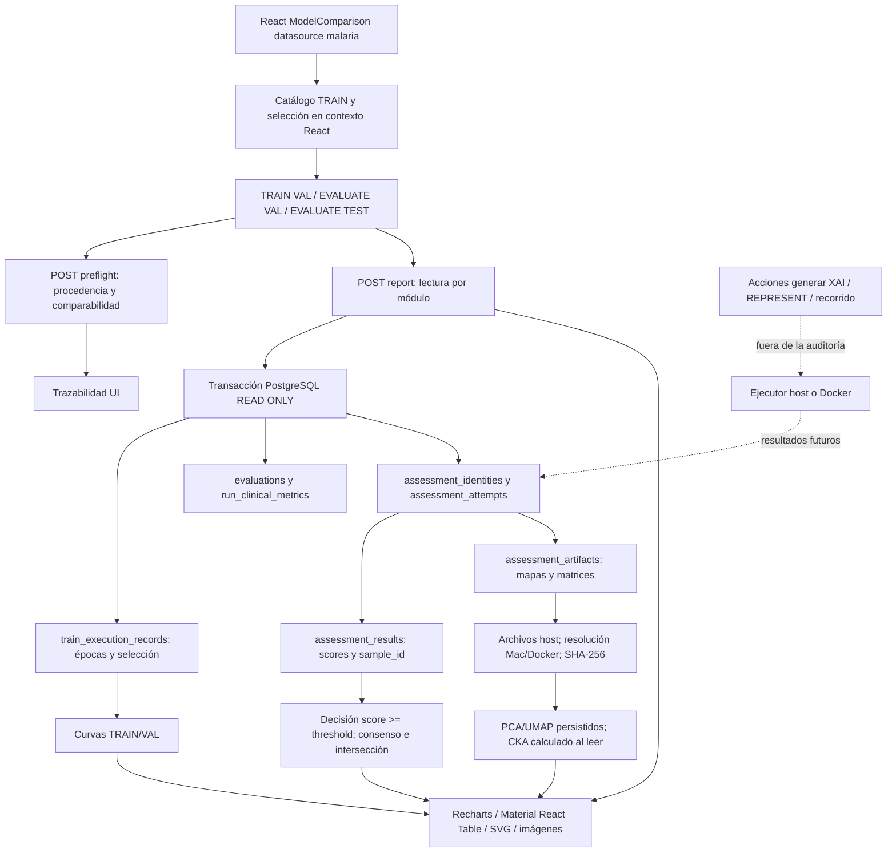

# CAPSTONE-P3-04 — Arquitectura y flujos

Fecha: 16 de noviembre de 2026, America/Santiago. Datasource: `malaria`.

**HECHO VERIFICADO.** El identificador solicitado `00b8d407-c672-4b68-9814-53c092d034ba` no es una fila de `runs`: es `assessment_attempts.id`, tipo `evaluate`, split **TEST**, estado `verified`. Su identidad es `a981125c-a9b6-4bec-9fb7-2fa52b907147` y su TRAIN es `87b3eff7-e09a-41c8-945d-bf31b3541adb`. La auditoría conserva el UUID pedido como caso principal y utiliza su TRAIN únicamente para reconstruir el entrenamiento y sus descendientes. Evidencia: [consulta de identidad](sql/principal_identity.sql), [captura](evidence/principal_identity.json), [identidad completa](evidence/principal_full_identity.json).

Convenciones: **HECHO VERIFICADO** = código/registro/archivo observado; **CÁLCULO REPRODUCIDO** = cálculo independiente sobre evidencia existente; **INTERPRETACIÓN CIENTÍFICA** = lectura con límites; **HIPÓTESIS** = explicación no demostrada; **PENDIENTE** = no comprobado. La existencia de código, de un registro `verified` y de un archivo con checksum coincidente son tres evidencias diferentes.

## Flujo completo

Los arcos punteados describen capacidades de ejecución; no se activaron. Docker mantiene frontend/API/BD; los TRAIN/assessments auditados registran ejecución local Python en Mac. PostgreSQL es fuente registral y los binarios viven en el host. El mapeo de rutas no convierte un archivo registrado en archivo existente.

## Matriz de las siete opciones

| Opción | Frontend | Endpoint | Función backend | Tablas | Artefactos | Cálculos | Gráficos |
|---|---|---|---|---|---|---|---|
| Aprendizaje | TrainingCurves | report module=curves | comparison_epochs / checkpoint_evidence | train_execution_records, run_configurations, artifacts, runs | checkpoint referenciado | lectura épocas, gap | líneas TRAIN/VAL |
| Clínico | ClinicalMetrics | report module=metrics | metrics / assessment_metrics / metric_dto | evaluations, run_clinical_metrics, assessment_identities/attempts | ninguno para tasas ya calculadas | tasas persistidas | barras, matrices, sensibilidad/especificidad |
| Errores | ConsensusResults / ConsensusSamplesTable | report module=consensus | prediction_population / validate_samples / consensus | assessment_results, dataset_split_assignments; eventos VAL | original celular | intersección, decisiones y conteos | distribución, heatmaps, tabla |
| XAI | PersistedXAI / GeneratedXAIComparison | assessments; artifacts/file | AssessmentReadService; scientific_artifact | assessment_identities/attempts/results/artifacts | map.npy, overlay.png | atribuciones generadas antes; UI compone | original, mapas y superposición |
| Arquitectura | ArchitecturePanel / ArchitectureDetail | runs/{id}/architecture; activation-traces | normalize_keras / normalize_biomedclip | train_execution_records runtime, run_configurations, model_versions, artifacts | caché estructura/recorridos cuando existen | formas y conteo de pesos | SVG, tablas, fórmulas |
| Representaciones | ScientificRepresentations | report module=representations | representation_evidence / cka_matrix | assessment_* | embeddings.npy,pca.npy,pca_variance.npy,umap.npy | lectura PCA/UMAP; CKA al consultar | scatter, varianza, matriz CKA |
| Trazabilidad | PreflightEvidence | comparison/preflight | ScientificPreflightService.read | dataset_*, runs, artifacts, assessments, evaluaciones | referencias; no todos se abren | validaciones de comparabilidad | dimensiones, dictámenes, referencias |

## Endpoints efectivos y efectos

| Método | Ruta relativa al backend | Función | Contrato / efecto |
|---|---|---|---|
| GET | /models?view=traceability&comparison=true | CatalogService.models | catálogo, elegibilidad, capacidad |
| GET | /runs/training-summaries | list_training_summaries | selector TRAIN, limit100 |
| GET | /runs/{id}/lineage-children | get_lineage_children | slots y EXPLAIN, paginación |
| POST | /models/comparison/preflight | ScientificPreflightService.read | identidades explícitas, dictámenes y procedencia |
| POST | /models/comparison/report | ScientificReportService.read | module catalog/curves/metrics/consensus/questions/representations |
| GET | /assessments | AssessmentReadService.list | TRAIN, campaña, offset, limit, view |
| GET | /assessments/{attempt_id} | AssessmentReadService.detail | identidad congelada, estado y verificación |
| GET | /assessments/{attempt_id}/results | AssessmentReadService.payloads | scores/resultados; sample_id[] |
| GET | /assessments/{attempt_id}/artifacts | AssessmentReadService.payloads | metadatos paginados; no certifica existencia |
| GET | /artifacts/file | artifact_file | original, training o assessment; valida pertenencia/integridad |
| GET | /runs/{run_id}/architecture | ModelArchitectureService.read | Keras registros; ViT caché derivable, efecto potencial |
| GET | /runs/{run_id}/activation-traces | ActivationTraceService.catalog | catálogo de recorridos guardados |
| GET | /runs/{run_id}/activation-traces/candidates | ActivationTraceService.candidates | FN/FP/etc según evaluación elegida por repo |
| GET | /runs/{run_id}/activation-traces/{sample_id} | ActivationTraceService.read | lee recorrido JSON; 404 ausente |
| POST / DELETE | /runs/{run_id}/activation-traces[/{sample_id}] | ActivationTraceService.create/delete | genera o elimina; NO ejecutado |
| GET | /runs/{run_id}/training-trajectories | TrainingTrajectoryService.read | trayectorias de scores VAL; utilizado por vistas complementarias |
| GET | /explain-generations[ /executor] | ExplainService.state / executor | estado y disponibilidad ejecutor |
| POST | /explain-generations/prepare ; /explain-generations | prepare / generate | preparación y ejecución; NO ejecutados |
| GET / POST | /representation-generations | RepresentService.state / generate | consulta / reserva ejecución; POST NO ejecutado |
| GET | /runs/{run_id}/scientific-results?view=traceability | ScientificReadService.read | contrato general; no sustituye report modules |

Referencias de ruta: [backend_api/app/routes/scientific_preflight.py:47](../../../backend_api/app/routes/scientific_preflight.py#L47); [backend_api/app/routes/assessments.py:44](../../../backend_api/app/routes/assessments.py#L44); [backend_api/app/routes/artifacts.py:15](../../../backend_api/app/routes/artifacts.py#L15); [backend_api/app/routes/model_architecture.py:13](../../../backend_api/app/routes/model_architecture.py#L13); [backend_api/app/routes/explain_generation.py:67](../../../backend_api/app/routes/explain_generation.py#L67); [backend_api/app/routes/representation_generation.py:46](../../../backend_api/app/routes/representation_generation.py#L46). Inventario adicional de declaraciones exactas, parámetros y decoradores en [endpoints_static.csv](csv/endpoints_static.csv); los prefijos del router deben anteponerse a declaraciones locales.

## Contratos, permisos y errores

`ScientificReportRequest` extiende PreflightRequest: selección explícita training_run_id, evaluación histórica o assessment identity_id+attempt_id, split/checkpoint opcionales; module obligatorio. offset≥0, limit1–100; categorías cerradas, label0/1, rangos de score por índice0–9, búsqueda≤200 caracteres y orden validado. No se elige una evaluación porque su UUID se parezca al TRAIN.

Preflight/report requieren RUNS_READ y permisos MODELS_READ, DATASETS_READ, PREDICTIONS_READ, ARTIFACTS_READ; principal local inseguro rechazado 401, insuficiencia403. UUID no encontrado404, identidad/split/checkpoint contradictorios422, SQL fallido503. Header `Cache-Control: private, no-store`. El permiso de generar explicaciones es separado del de leer. El replay directo verifica servicio/datos, no RBAC ni proxy HTTP.

`read_only_transaction` configura READ ONLY, statement timeout10s, lock timeout2s y rollback al terminar; módulos complejos usan REPEATABLE READ. La extracción SQL de auditoría tiene 60s por sentencia. Referencia [backend_api/app/db.py:69](../../../backend_api/app/db.py#L69).

## React, estado y procedencia

Ruta [frontend/src/router.ts:16](../../../frontend/src/router.ts#L16); entrada [frontend/src/pages/ModelComparison.tsx:21](../../../frontend/src/pages/ModelComparison.tsx#L21). Datasource se pasa desde App y se propaga al cliente API; solo `malaria` está habilitado en backend. TRAIN seleccionados se conservan en ComparisonSelectionProvider (memoria, no se inventa persistencia URL/localStorage). `seccion`, `muestra`, `modelo`, `evaluacion` son parámetros de navegación; evaluación global por defecto TEST, con fallback TEST→VAL→TRAIN y override por tarjeta. Los IDs seleccionados no se derivan del parámetro `modelo`, que controla la arquitectura visible.

Hay una pestaña adicional **Resumen**, además de las siete solicitadas. Los paneles se montan al primer acceso y se mantienen ocultos después; filtros y caché en memoria sobreviven al cambio de pestaña. useComparisonEvidence controla consulta, estado de carga, error/reintento y cache key (datasource, identidades, revisión). Cambiar usuario/permisos/datasource/conjunto TRAIN remonta la sesión. No hay sustitución de resultados científicos por mocks en este flujo identificado. Valores ausentes se muestran como «Sin evidencia», «—», missing/incompatible; no se rellenan curvas faltantes.

Tipos: `types/scientificReport.ts`, `scientificPreflight.ts`, `scientificRead.ts`, `modelArchitecture.ts`, `api.ts`; clientes en [frontend/src/services/api.ts:644](../../../frontend/src/services/api.ts#L644). Hooks `useComparisonCatalog`, `useComparisonSelection`, `useComparisonTrainingSummaries`, `useComparisonEvidence`, `useExplainExecutor`. La galería XAI agrega métodos/célula mediante `xai/comparison.ts`; no recalcula atribuciones.

Visualización: Recharts (líneas, barras, scatter), Material React Table (filtros/orden/paginación), SVG y JSX propios para arquitectura y fórmulas. Los gráficos de arquitectura incluyen dibujos pedagógicos y bloques de referencia ViT identificados, no mediciones de activación salvo recorrido persistido. Exportación: copiar ID/enlace/comandos y descargar binarios mediante artefactos; no se encontró un exportador integral de las siete opciones. Los CSV de esta auditoría son productos nuevos de documentación.

## Precedencia y cachés

Curvas: eventos `kind=epoch` → normalización numérica/validación de eje → UI; no fallback a training_history. Configuración: run_configurations primero, si no existe configuración resolved de runs.execution_parameters. Checkpoint: contexto e10 en runs referencia artifacts, último evento selection define época/fase. Histórico clínico: evaluations+run_clinical_metrics; independiente: assessment verification.metrics, sin completar medidas ausentes silenciosamente. REPRESENT: último intento verified que coincide exactamente en población ordenada, decisión, split, purpose, checkpoint, hash, dataset y especificación; luego SHA y shape físicos. XAI: métodos elegidos explícitamente por tarjeta; puede admitir distinto split/checkpoint y advertirlo. CKA no se guarda: depende de la comparación solicitada.

La arquitectura ViT es la excepción a una lectura sin escritura de archivos: [backend_api/app/services/vit_structure.py:35](../../../backend_api/app/services/vit_structure.py#L35) deriva caché por hash cuando falta. Se evitó ejecutar esa rama. Recorridos se generan mediante POST y se consultan mediante GET; no se generaron durante esta auditoría.

## Admisión y catálogo comprobados

La respuesta de `/models?view=traceability&comparison=true` se reprodujo desde CatalogService con transacción de solo lectura. Ofrece custom_cnn (16 elegibles/23 TRAIN), DenseNet121 (14/18) y VGG16 (14/18), máximo cuatro participantes. El filtro classification excluye las tres modalidades BiomedCLIP que usan otros model_type. Esto es una limitación de acceso real de la página; los runtimes Torch y sus registros siguen existiendo. EXPLAIN no bloquea admisión: TRAIN y EVALUATE acreditados sí. [Respuesta](evidence/catalog_response.json).

### Exportación y color XAI: precisión del contrato

Además de copiar enlaces/IDs y descargar archivos, la trazabilidad XAI ofrece un JSON completo por método. El PNG persistido de LIME/SHAP representa magnitud, pero la vista canvas Superposición lee el NPY firmado y sí distingue rojo positivo/azul negativo con opacidad por capa. Ver la ficha05 antes de interpretar colores o exportar una captura.
