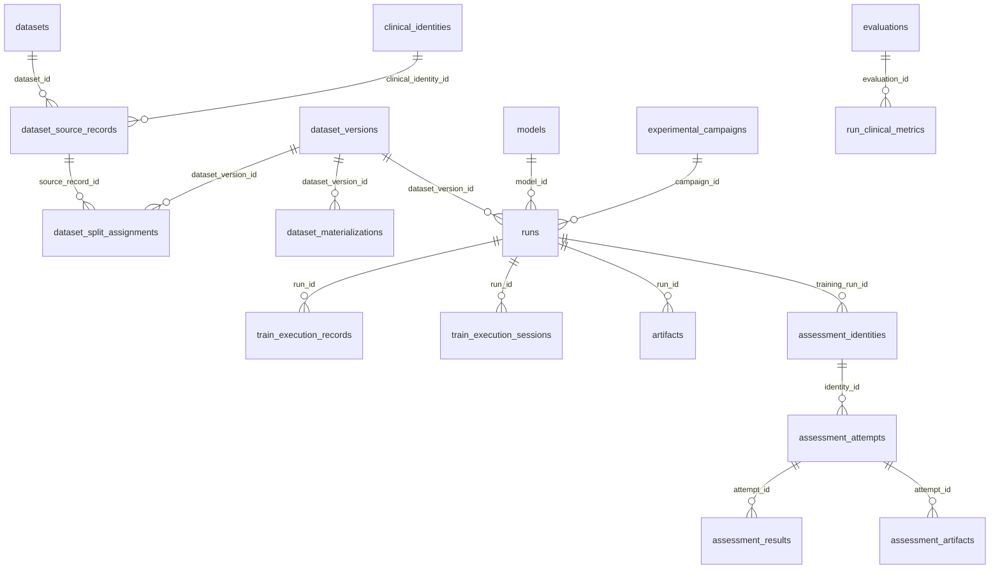

# CAPSTONE-P3-04 — Datos, claves, persistencia y artefactos

Fecha: 16 de noviembre de 2026, America/Santiago. Datasource: `malaria`.

**HECHO VERIFICADO.** El identificador solicitado `00b8d407-c672-4b68-9814-53c092d034ba` no es una fila de `runs`: es `assessment_attempts.id`, tipo `evaluate`, split **TEST**, estado `verified`. Su identidad es `a981125c-a9b6-4bec-9fb7-2fa52b907147` y su TRAIN es `87b3eff7-e09a-41c8-945d-bf31b3541adb`. La auditoría conserva el UUID pedido como caso principal y utiliza su TRAIN únicamente para reconstruir el entrenamiento y sus descendientes. Evidencia: [consulta de identidad](sql/principal_identity.sql), [captura](evidence/principal_identity.json), [identidad completa](evidence/principal_full_identity.json).

Convenciones: **HECHO VERIFICADO** = código/registro/archivo observado; **CÁLCULO REPRODUCIDO** = cálculo independiente sobre evidencia existente; **INTERPRETACIÓN CIENTÍFICA** = lectura con límites; **HIPÓTESIS** = explicación no demostrada; **PENDIENTE** = no comprobado. La existencia de código, de un registro `verified` y de un archivo con checksum coincidente son tres evidencias diferentes.

## Esquema actual y relaciones verificadas

El esquema procede de information_schema.columns y pg_constraint, no de nombres propuestos en una documentación antigua. Columnas y tipos completos: [schema.json](evidence/schema.json); PK/FK/UNIQUE/CHECK: [constraints.json](evidence/constraints.json); triggers reales: [triggers.json](evidence/triggers.json); vistas: [views.json](evidence/views.json). Su existencia no prueba que todas las reglas se hayan ejercitado en esta auditoría; no se hicieron pruebas de escritura contra la BD científica.

| Tabla | Columnas reales | PK y FK declaradas |
|---|---|---|
| datasets | id, name, source, version, description, total_images, num_classes, class_names, class_distribution, license, url, local_path, checksum, created_at, metadata, provider, source_type, source_reference, source_version | PRIMARY KEY (id) |
| clinical_identities | id, dataset_id, identity_type, source_identifier, status, metadata, created_at, updated_at | FOREIGN KEY (dataset_id) REFERENCES datasets(id) ON DELETE RESTRICT; PRIMARY KEY (id) |
| dataset_source_records | id, dataset_id, clinical_identity_id, source_record_key, tfds_index, source_filename, class_index, class_name, original_label, project_label, relative_source_key, source_file_sha256, decoded_pixel_sha256, image_width, image_height, file_size_bytes, identity_status, metadata, created_at, updated_at | FOREIGN KEY (clinical_identity_id) REFERENCES clinical_identities(id) ON DELETE RESTRICT; FOREIGN KEY (dataset_id) REFERENCES datasets(id) ON DELETE RESTRICT; PRIMARY KEY (id) |
| dataset_versions | id, name, semantic_version, status, grouping_strategy, grouping_field, stratification_strategy, split_algorithm, split_algorithm_version, random_seed, target_train_ratio, target_val_ratio, target_test_ratio, positive_class, class_mapping, source_record_count, methodology_json, created_at, generated_at, validated_at, frozen_at, archived_at | PRIMARY KEY (id) |
| dataset_split_assignments | id, dataset_version_id, source_record_id, clinical_identity_id, split_name, class_index, class_name, metadata, created_at | FOREIGN KEY (clinical_identity_id) REFERENCES clinical_identities(id) ON DELETE RESTRICT; FOREIGN KEY (dataset_version_id) REFERENCES dataset_versions(id) ON DELETE RESTRICT; PRIMARY KEY (id); FOREIGN KEY (source_record_id) REFERENCES dataset_source_records(id) ON DELETE RESTRICT |
| dataset_materializations | id, dataset_version_id, attempt_number, status, reconciliation_status, relative_root, record_count, manifest_metadata, started_at, completed_at, failure_reason, metadata, created_at | FOREIGN KEY (dataset_version_id) REFERENCES dataset_versions(id) ON DELETE RESTRICT; PRIMARY KEY (id) |
| dataset_split_validation_checks | id, dataset_version_id, check_name, status, observed_value, expected_value, details_json, blocking_for_validation, blocking_for_freeze, executed_at | FOREIGN KEY (dataset_version_id) REFERENCES dataset_versions(id) ON DELETE RESTRICT; PRIMARY KEY (id) |
| experimental_campaigns | id, experiment_id, name, purpose, state, dataset_version_id, dataset_snapshot, dataset_evidence_id, requested, protocol, environment, registry_snapshot, contract, canonical_contract, contract_hash, expected_count, actor, created_at, updated_at, frozen_at | FOREIGN KEY (dataset_evidence_id) REFERENCES audit_events(id) ON DELETE RESTRICT; FOREIGN KEY (dataset_version_id) REFERENCES dataset_versions(id) ON DELETE RESTRICT; FOREIGN KEY (experiment_id) REFERENCES experiments(id) ON DELETE RESTRICT; PRIMARY KEY (id) |
| models | id, name, model_type, framework, architecture, description, input_shape, output_shape, num_parameters, pretrained, pretrained_source, created_at, metadata | PRIMARY KEY (id) |
| runs | id, experiment_id, model_id, dataset_id, run_name, run_type, status, command, script_name, started_at, finished_at, duration_seconds, user_name, host_name, working_directory, git_commit, git_branch, python_version, platform, machine, processor, gpu_available, gpu_devices, random_seed, parameters, notes, created_at, updated_at, metadata, execution_type, execution_parameters, fine_tuning_start_epoch, total_epochs, completed_epochs, max_epochs, stopped_epoch, best_epoch, checkpoint_monitor, checkpoint_mode, best_validation_value, early_stopping_enabled, early_stopping_patience, early_stopping_min_delta, restore_best_weights, backend_version, pipeline_version, configuration, error_message, dataset_version_id, release_status, release_updated_at, release_changed_by, release_reason, campaign_id, peak_cpu_memory_bytes, peak_gpu_memory_bytes | FOREIGN KEY (campaign_id) REFERENCES experimental_campaigns(id); FOREIGN KEY (dataset_id) REFERENCES datasets(id) ON DELETE RESTRICT; FOREIGN KEY (dataset_version_id) REFERENCES dataset_versions(id) ON DELETE RESTRICT; FOREIGN KEY (experiment_id) REFERENCES experiments(id) ON DELETE RESTRICT; FOREIGN KEY (model_id) REFERENCES models(id) ON DELETE RESTRICT; PRIMARY KEY (id) |
| run_configurations | run_id, architecture, adapter_version, optimizer, learning_rate, fine_tune_learning_rate, batch_size, random_seed, max_epochs, fine_tune_epochs, early_stopping, early_stopping_patience, early_stopping_min_delta, early_stopping_monitor, early_stopping_mode, restore_best_weights, checkpoint_monitor, checkpoint_mode, dropout, l2, input_height, input_width, input_channels, weights, fine_tune_layers, normalization, internal_preprocessing, loss_function, calibration_enabled, default_threshold, clinical_target_recall, configuration_hash, canonical_configuration, optimizer_extensions, extension_configuration, provenance_snapshot, created_at | FOREIGN KEY (architecture) REFERENCES models(name) ON UPDATE RESTRICT ON DELETE RESTRICT; FOREIGN KEY (run_id) REFERENCES runs(id) ON DELETE RESTRICT; PRIMARY KEY (run_id) |
| train_execution_sessions | run_id, attempt_id, owner, host, parent_pid, child_pid, state, configuration, dataset, environment, artifact_root, cause, started_at, updated_at, completion, verification | FOREIGN KEY (attempt_id) REFERENCES campaign_attempts(id); PRIMARY KEY (run_id); FOREIGN KEY (run_id) REFERENCES runs(id) |
| train_execution_records | run_id, kind, phase, record_key, payload, created_at, event_id, event_sequence | PRIMARY KEY (run_id, kind, phase, record_key); FOREIGN KEY (run_id) REFERENCES train_execution_sessions(run_id) |
| artifacts | id, run_id, artifact_type, name, path, mime_type, file_size_bytes, checksum, created_at, metadata, artifact_uri, artifact_status, archived_at | PRIMARY KEY (id); FOREIGN KEY (run_id) REFERENCES runs(id) ON DELETE RESTRICT |
| model_versions | id, model_id, version_name, checkpoint_path, final_model_path, best_model_path, training_run_id, created_at, metadata, model_name, version_number, checkpoint_artifact_id, artifact_uri, artifact_sha256, artifact_size_bytes, artifact_hash_reuse_justification, framework, framework_version, preprocessing_profile_snapshot, class_mapping, input_signature, output_signature, status, lineage_status, validated_at, approved_at, retired_at | FOREIGN KEY (checkpoint_artifact_id, training_run_id) REFERENCES artifacts(id, run_id) ON DELETE RESTRICT; FOREIGN KEY (model_id) REFERENCES models(id) ON DELETE RESTRICT; PRIMARY KEY (id); FOREIGN KEY (training_run_id) REFERENCES runs(id) ON DELETE RESTRICT |
| evaluations | id, run_id, training_run_id, model_version_id, checkpoint_artifact_id, dataset_version_id, split, evaluation_role, purpose, dataset_origin_id, dataset_origin_role, population_manifest_uri, population_manifest_sha256, dataset_provenance_uri, dataset_provenance_sha256, subject_kind, protocol_version, protocol_hash, population_hash, input_contract_hash, comparison_contract_hash, protocol_snapshot, source_kind, source_record_key, source_record_phase, source_event_id, event_kind, event_phase, event_key, source_assessment_attempt_id, threshold_used, threshold_source, calibration_id, metric_definition, created_at | FOREIGN KEY (run_id, event_kind, event_phase, event_key) REFERENCES train_execution_records(run_id, kind, phase, record_key) DEFERRABLE INITIALLY DEFERRED; FOREIGN KEY (dataset_version_id, dataset_origin_id, dataset_origin_role) REFERENCES dataset_version_sources(dataset_version_id, dataset_id, role) ON DELETE RESTRICT; FOREIGN KEY (calibration_id) REFERENCES run_threshold_calibration(run_threshold_calibration_id) ON DELETE RESTRICT DEFERRABLE INITIALLY DEFERRED; FOREIGN KEY (dataset_version_id) REFERENCES dataset_versions(id) ON DELETE RESTRICT; FOREIGN KEY (training_run_id) REFERENCES runs(id) ON DELETE RESTRICT; FOREIGN KEY (checkpoint_artifact_id) REFERENCES artifacts(id) ON DELETE RESTRICT; FOREIGN KEY (model_version_id, training_run_id) REFERENCES model_versions(id, training_run_id) ON DELETE RESTRICT; FOREIGN KEY (source_assessment_attempt_id) REFERENCES assessment_attempts(id) ON DELETE RESTRICT; FOREIGN KEY (run_id) REFERENCES runs(id) ON DELETE RESTRICT; PRIMARY KEY (id) |
| run_clinical_metrics | run_clinical_metric_id, run_id, model_id, model_name, split_name, threshold_used, threshold_source, accuracy, precision_parasitized, recall_parasitized, sensitivity_parasitized, specificity, f1_parasitized, f2_parasitized, roc_auc_parasitized, pr_auc_parasitized, balanced_accuracy, tn, fp, fn, tp, confusion_matrix, classification_report, prediction_distribution, prediction_collapse, label_mapping_version, raw_model_score_meaning, created_at, metadata, evaluation_id, sample_count, auc_unavailability_reason | FOREIGN KEY (evaluation_id, run_id) REFERENCES evaluations(id, run_id) ON DELETE RESTRICT; FOREIGN KEY (model_id) REFERENCES models(id) ON DELETE RESTRICT; PRIMARY KEY (run_clinical_metric_id); FOREIGN KEY (run_id) REFERENCES runs(id) ON DELETE RESTRICT |
| run_threshold_calibration | run_threshold_calibration_id, run_id, model_name, threshold_policy, threshold_source, threshold_selected, default_threshold, target_recall, target_recall_satisfied, min_specificity, validation_recall_at_threshold, validation_specificity_at_threshold, validation_precision_at_threshold, validation_f1_at_threshold, validation_f2_at_threshold, validation_balanced_accuracy_at_threshold, validation_pr_auc, validation_roc_auc, default_threshold_metrics, selected_threshold_metrics, candidate_count, threshold_warning, calibration_split, threshold_calibration_path, model_metadata_path, created_at, metadata, model_version_id, calibration_artifact_id, score_name, label_mapping_version, positive_label, calibration_status, default_evaluation_id, selected_evaluation_id | FOREIGN KEY (calibration_artifact_id, run_id) REFERENCES artifacts(id, run_id) ON DELETE RESTRICT; FOREIGN KEY (model_version_id) REFERENCES model_versions(id) ON DELETE RESTRICT; PRIMARY KEY (run_threshold_calibration_id); FOREIGN KEY (run_id) REFERENCES runs(id) ON DELETE RESTRICT; FOREIGN KEY (default_evaluation_id) REFERENCES evaluations(id) ON DELETE RESTRICT DEFERRABLE INITIALLY DEFERRED; FOREIGN KEY (selected_evaluation_id) REFERENCES evaluations(id) ON DELETE RESTRICT DEFERRABLE INITIALLY DEFERRED |
| run_checkpoint_policy | run_checkpoint_policy_id, run_id, model_name, checkpoint_policy, checkpoint_policy_config, selected_epoch, policy_satisfied, selected_metric, selected_metric_value, min_recall_required, val_recall_parasitized_selected, val_f2_parasitized_selected, val_specificity_selected, val_auc_selected, val_pr_auc_selected, val_balanced_accuracy_selected, prediction_collapse_detected, all_epochs_collapsed, checkpoint_warning, checkpoint_path, checkpoint_policy_summary_path, model_metadata_path, created_at, metadata, model_version_id, checkpoint_artifact_id | FOREIGN KEY (checkpoint_artifact_id, run_id) REFERENCES artifacts(id, run_id) ON DELETE RESTRICT; FOREIGN KEY (model_version_id, run_id) REFERENCES model_versions(id, training_run_id) ON DELETE RESTRICT; FOREIGN KEY (model_version_id, checkpoint_artifact_id) REFERENCES model_versions(id, checkpoint_artifact_id) ON DELETE RESTRICT; PRIMARY KEY (run_checkpoint_policy_id); FOREIGN KEY (run_id) REFERENCES runs(id) ON DELETE RESTRICT |
| assessment_identities | id, identity_hash, training_run_id, kind, identity, canonical_identity, structural_hash, created_at | PRIMARY KEY (id); FOREIGN KEY (training_run_id) REFERENCES runs(id) |
| assessment_attempts | id, identity_id, owner, host, pid, ordinal, state, artifact_root, cause, verification, started_at, finished_at | FOREIGN KEY (identity_id) REFERENCES assessment_identities(id); PRIMARY KEY (id) |
| assessment_results | attempt_id, sample_id, payload | FOREIGN KEY (attempt_id) REFERENCES assessment_attempts(id); PRIMARY KEY (attempt_id, sample_id) |
| assessment_artifacts | attempt_id, artifact_id, sample_id, role, payload | FOREIGN KEY (attempt_id) REFERENCES assessment_attempts(id); PRIMARY KEY (attempt_id, sample_id, role) |

El diagrama resume claves verificadas; **los IDs dentro de JSON E5/assessment pueden ser identidades lógicas y no FK a artifacts/model_versions**. El linaje por contenido se comprueba en sesión/hash. `dataset_split_images` y `run_dataset_images` pertenecen a contratos adicionales, no sustituyen dataset_source_records para sample_id de assessment. Las tablas `research_subjects`, `scientific_cases`, `blood_samples`, `smear_slides`, `microscopy_images`, `cell_*` representan el flujo de frotis del sistema: no se inventa una unión desde crops experimentales si no existe.

## Catálogo físico completo del registro auditado

[artifact_inventory.csv](csv/artifact_inventory.csv) entrega una fila por referencia: tabla,artifact_id,run_id/attempt_id,sample_id,role,extensión,ruta registrada/ruta resuelta,bytes esperados/observados,SHA esperado/observado,existencia y estado de hash. Son **35.341 referencias**:87 artifacts genéricos y35.254 assessment_artifacts;29.955 archivos existentes en las rutas comprobadas,5.386 ausentes. No se deducen registros a partir de carpetas. SHA comprobado43, coinciden43, otros35.298 quedan not_checked (incluye ausentes y existentes no hasheados). El muestreo de hashing es explícito: checkpoint principal,18 XAI principales y24 matrices de seis REPRESENT. Las cuatro imágenes originales comprobadas están aparte.

`assessment_artifacts`:17.615 mapas.npy,17.615 overlays.png y6×4 matrices. `artifacts`:83 model_checkpoint y4 model_dependency. Las extensiones exactas por fila están en CSV, no se presupone que todos los checkpoints sean .keras. Los paths no se publican por la API de trazabilidad: public_evidence elimina localizadores; este informe local conserva rutas para reproducción.

**Archivos auxiliares locales:** inspección limitada a carpeta TRAIN principal, sus recorridos y caché de estructuras: [local_auxiliary_files.csv](csv/local_auxiliary_files.csv),32 archivos (28 checkpoints.keras,3 recorridos.json,1 estructura.json). Son inventario de carpeta acotada, no todos registrados como artifacts genéricos. Solo el checkpoint seleccionado se hash-comprobó contra registro; no se hashearon1.7GB de checkpoints intermedios ni se copiaron. No se hallaron CSV/logs/historial.json en ese directorio acotado; las épocas y scores están en PostgreSQL. No se afirma ausencia global de esas extensiones en el repositorio.

## Productores, consumidores y función científica

| Tipo | Formato / etapa | Productor | Registro | Recuperación / consumidor | Función / límite |
|---|---|---|---|---|---|
| Checkpoint elegido |.keras o.pt/.bin según modelo; TRAIN/registro |executor TRAIN + finalización E5/e10 |artifacts; train_execution_sessions.verification; contextoruns |lineage.resolve / runtimes; no UI descarga sin contrato |pesos exactos y fase/época; ID lógico≠FK |
| Dependencias base OpenCLIP |JSON/vocab/pesos según rol |registro pretrained |artifacts rolemodel_dependency + version profile |registered_dependencies, runtimeOpenCLIP |transform/tokenización reproducible |
| Historial épocas |JSON payload, no archivo requerido |callbacks/training event recorder |train_execution_records kind epoch |comparison_epochs→TrainingCurves |loss y medidas por época, no TEST |
| Selección/checkpoint |JSON payload |checkpoint_policy / selección |train_execution_records kind selection y sesión |checkpoint_evidence / Curves/Arquitectura |ranking efectivo y warnings |
| Calibración con scores VAL |JSON payload/result/samples |find_threshold_for_target_recall y TRAIN |event calibration + run_threshold_calibration + evaluations |assessment.threshold auto / reporte |selección de t, no ajuste de probabilidades |
| Scores por célula |JSON fila |prediction / execute_reserved |assessment_results |reportconsensus, tablas, original/XAI |label/score/threshold/predicho con sample/patient |
| Mapa XAI |.npy float32 |runtime.explain→save_artifacts |assessment_artifacts payload |artifacts/file→visorXAI |gradiente/surrogate/expected gradients |
| Overlay XAI |.png uint8 |save_artifacts |assessment_artifacts role overlay |ScientificArtifact/GeneratedXAIComparison |representación visual; LIME/SHAP usa abs |
| Embeddings |.npy float32 N×d |runtime.represent→represent_reserved→save_arrays |assessment_artifacts role embeddings, result.row |representation_evidence→CKA |vector del extractor antes de cabeza |
| PCA coordenadas |.npy float32 N×2 |project(sklearnPCA) |assessment_artifacts role pca |RepresentationResults |proyección lineal descriptiva |
| PCA varianza |.npy float64 ≤50 |project |assessment_artifacts role pca_variance |VarianceChart/KPI |fracción de varianza, no exactitud |
| UMAP |.npy float32 N×2 |project(umapUMAP) |assessment_artifacts role umap |ProjectionChart |geometría local aproximada |
| CKA |JSON response, sin archivo propio |linear_cka/cka_matrix al leer |no persistencia de par |CkaHeatmap |similitud normalizada sobre intersección |
| EstructuraViT |.json por hash de base |vit_structure_compute |caché filesystemmodel_structure_root |ModelArchitectureService |formas/pesos de estructura, no nuevos pesos |
| Recorrido celular |.json con stats y PNGbase64 |activation_trace_compute/vit_trace_compute, por POST |filesystemactivation_trace_root/TRAIN/sample.json |ActivationTracePanel,TraceCharts |activaciones y score de una célula; no gradiente causal |
| Original celular |.png de materialización |dataset split/materialización |dataset_source_records SHA + assignment |original_sample_image→artifacts/file |crop, paciente fuente, etiqueta y split |
| Figuras de auditoría |.png |evidence/compute.py |solo este directorio |P3/lector informe |derivadas, no capturas UI ni artefactos productivos |

Rutas/productores exactos y líneas en catálogo 03. Los CSV conservan identificadores físicos por fila y los JSON originales guardan metadata completa. Extensiones no vistas en el contrato principal (.svg estático, reportesPDF,logs) se distinguen de los SVG calculados en frontend y de evidencia histórica de otros informes.

## Casos de integridad que requieren cuidado

- El EXPLAIN ceaa29af… figura verified pero sus5.386 binarios faltan en ambas resoluciones registradas disponibles; no se regeneran para ocultar la diferencia. Su estado verificaba una ejecución pasada, no presencia continua.
- `file_availability=not_checked` en DTO no significa `available` ni `missing` físico. El inventario comprueba filesystem separadamente.
- Cuatro matrices REPRESENT tienen un sample_id ancla único en artifacts y filas por toda la población en results. No contar cuatro células representadas.
- Version E5e8f94… y checkpoint lógico3bbb… se reconstruyen desde sesión/UUIDv5; artifacts5406… es proyección distinta del mismo archivo b26f….
- Sesiones, identities y resultados pueden conservar distintos git_commit de planificación/ejecución. Para reproducir usar runtime y source_sha más contrato de dependencias; no tomar el README actual como versión histórica.

## Versiones observadas del caso principal

TRAIN y TEST: TF2.17.1,Keras3.15.1,NumPy1.26.4,Python3.12.13. LIME0.2.0.1,scikit-image0.26.0,sklearn1.9.1; SHAP0.49.1; REPRESENT umap-learn0.5.12 ysklearn1.9.1; Pillow12.3.0,matplotlib3.11.2. Fuente: identity.code/inference_packages de cada intento, no versión web actual. El TEST antiguo no guardó sklearn en inference_packages, aunque las ejecuciones XAI/REPRESENT posteriores sí lo hacen; no reescribir retrospectivamente esa ausencia.

### Exportación y color XAI: precisión del contrato

Además de copiar enlaces/IDs y descargar archivos, la trazabilidad XAI ofrece un JSON completo por método. El PNG persistido de LIME/SHAP representa magnitud, pero la vista canvas Superposición lee el NPY firmado y sí distingue rojo positivo/azul negativo con opacidad por capa. Ver la ficha05 antes de interpretar colores o exportar una captura.
